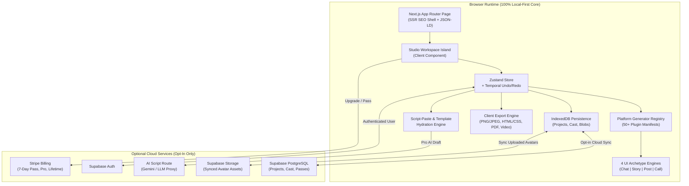

# System Architecture & Shared Generator Engine

**Document Status:** Phase 2 Architecture Specification (Pending Approval)  
**Target Product:** ChatForge — Social Media Chat & Mockup Creation Platform  
**Grounded In:** Phase 1 Research ([competitor-analysis.md](file:///Users/vaibhavborkar/chat%20generator/docs/research/competitor-analysis.md), [reddit-user-research.md](file:///Users/vaibhavborkar/chat%20generator/docs/research/reddit-user-research.md), [feature-gap-analysis.md](file:///Users/vaibhavborkar/chat%20generator/docs/research/feature-gap-analysis.md), [keyword-research.md](file:///Users/vaibhavborkar/chat%20generator/docs/research/keyword-research.md))

---

## 1. Architectural Goals & Design Principles

Phase 1 research established five non-negotiable engineering constraints for winning against legacy utilities (`fakedetail.com`, `zeoob.com`), modern studios (`thefake.design`, `getmockly.com`), and mobile prank apps (`WhatsMock`, `TextingStory`):

1. **Zero-Upload Client-Side Rendering by Default:** All mockup rendering, avatar composition, PNG/JPEG/HTML export, and video frame encoding run 100% locally in the browser. Supabase is strictly optional for cross-device cloud sync, authentication, and team workspaces.
2. **Plugin-Driven 50+ Generator Scalability:** Adding generator #11 or #50 must require **zero duplication** of the editor shell, state management, undo/redo engine, persistence layer, export pipeline, or SEO page wrapper. Each platform registers a declarative `PlatformManifest` and a focused `PlatformRenderer` component.
3. **SSR/SSG SEO Wrapper + Client Interactive Island:** Every `/generators/[slug]` route renders crawlable HTML (`<h1>`, instructions, FAQs, JSON-LD schemas) on the server while hydrating a dimension-locked interactive Studio island (`CLS < 0.05`).
4. **Local-First Durability:** Auto-save every edit to IndexedDB immediately so anonymous users never lose drafts on tab refresh, while keeping bundle size lean via code-split platform skins.
5. **Dual-Mode Architecture (Static + Animated):** The same underlying `Conversation` and `AnimationTimeline` state powers static HD screenshots, multi-slide carousels, animated video playback/MP4 export, interactive Prop Playback Mode, and live Fake Call Screen timers.

---

## 2. High-Level System Architecture



---

## 3. Repository & Folder Structure

A clean, feature-sliced modular Next.js App Router structure designed to scale cleanly to 50+ generators without file sprawl:

```text
chat-generator/
├── src/
│   ├── app/                              # Next.js App Router (SSR/SSG & Route Handlers)
│   │   ├── (marketing)/                  # Homepage, pricing, use-cases, compare, blog
│   │   ├── generators/
│   │   │   ├── page.tsx                  # All generators directory hub
│   │   │   └── [slug]/
│   │   │       └── page.tsx              # Dynamic SSG/ISR generator page + Studio island
│   │   ├── studio/                       # Full-screen multi-project workspace & prop mode
│   │   │   ├── page.tsx
│   │   │   └── prop/[projectId]/page.tsx # Filmmaker full-screen tap-to-advance mode
│   │   ├── api/                          # Optional Next.js Route Handlers
│   │   │   ├── health/route.ts
│   │   │   ├── ai/generate-script/route.ts
│   │   │   ├── sync/projects/route.ts
│   │   │   ├── templates/route.ts
│   │   │   └── webhooks/stripe/route.ts
│   │   ├── sitemap.ts
│   │   └── manifest.ts                   # PWA Web App Manifest
│   │
│   ├── core/                             # Framework-agnostic business logic & engine
│   │   ├── types/                        # Canonical TypeScript data models
│   │   │   ├── project.ts
│   │   │   ├── conversation.ts
│   │   │   ├── message.ts
│   │   │   ├── theme.ts
│   │   │   ├── export.ts
│   │   │   ├── template.ts
│   │   │   └── registry.ts
│   │   ├── registry/                     # Platform Plugin Registry (50+ generator support)
│   │   │   ├── index.ts
│   │   │   ├── capabilities.ts
│   │   │   └── manifests/                # Lightweight metadata + lazy loader per platform
│   │   ├── store/                        # Zustand slices + Undo/Redo temporal middleware
│   │   │   ├── useStudioStore.ts
│   │   │   ├── slices/
│   │   │   │   ├── projectSlice.ts
│   │   │   │   ├── conversationSlice.ts
│   │   │   │   ├── participantSlice.ts
│   │   │   │   ├── themeSlice.ts
│   │   │   │   ├── timelineSlice.ts
│   │   │   │   └── uiSlice.ts
│   │   │   └── middleware/undoRedo.ts
│   │   ├── engine/                       # Shared pure-TS engines
│   │   │   ├── scriptParser.ts           # "Name: Message" screenplay parser
│   │   │   ├── templateHydrator.ts       # Maps abstract role templates -> active platform
│   │   │   ├── fileSerialization.ts      # .chatforge.json import/export + schema migrations
│   │   │   ├── messageGrouping.ts        # Consecutive message grouping & tail logic
│   │   │   └── timeFormatter.ts          # Locale-aware timestamps & status strings
│   │   ├── export/                       # Client-side Export Pipeline
│   │   │   ├── imageExporter.ts          # html-to-image / html2canvas + 2x/3x/4x scaling
│   │   │   ├── longScrollExporter.ts     # Full-conversation tall PNG & sliced carousel ZIP
│   │   │   ├── htmlExporter.ts           # Semantic accessible HTML/CSS (AO3/fiction)
│   │   │   ├── pdfExporter.ts            # Print-ready / classroom PDF exporter
│   │   │   └── videoExporter.ts          # Phase 2+ WebCodecs / ffmpeg.wasm MP4 pipeline
│   │   └── storage/                      # Persistence adapters
│   │       ├── indexedDb.ts              # Dexie / idb local-first store + Blob assets
│   │       ├── supabaseSync.ts           # Optional cloud sync adapter
│   │       └── syncQueue.ts              # Offline-resilient delta sync queue
│   │
│   ├── components/
│   │   ├── ui/                           # shadcn/ui primitives (Button, Dialog, Tabs, etc.)
│   │   ├── studio/                       # Shared Editor Shell (used by ALL 50+ generators)
│   │   │   ├── StudioWorkspace.tsx
│   │   │   ├── EditorSidebar.tsx         # Adaptive tabs driven by PlatformCapabilities
│   │   │   ├── MessageComposer.tsx
│   │   │   ├── ParticipantManager.tsx    # Cast of Characters + per-chat members
│   │   │   ├── ThemeCustomizer.tsx
│   │   │   ├── DeviceFrameWrapper.tsx    # iPhone, Android, Desktop, Clean, Transparent
│   │   │   ├── ExportModal.tsx
│   │   │   ├── ScriptImportModal.tsx
│   │   │   ├── TemplatePickerModal.tsx
│   │   │   └── PreviewViewport.tsx
│   │   ├── shared-renderers/             # Reusable cross-platform visual building blocks
│   │   │   ├── StatusBar.tsx             # iOS Dynamic Island, Classic iOS, Android, Film-Safe
│   │   │   ├── AvatarBadge.tsx
│   │   │   ├── ReactionCluster.tsx
│   │   │   ├── VoiceNoteWaveform.tsx
│   │   │   ├── AttachmentRenderer.tsx    # Image, Video, Audio, GIF, Sticker, Doc, Loc, Contact
│   │   │   ├── CallEventRow.tsx
│   │   │   └── DisclosureWatermark.tsx   # Optional "Simulated / Educational" badge
│   │   └── seo/                          # SSR SEO blocks (HowTo, FAQAccordion, JsonLd)
│   │
│   └── platforms/                        # Isolated Platform Plugins (Lazy-loaded!)
│       ├── whatsapp-chat/
│       ├── whatsapp-group-chat/          # Shares WhatsApp tokens & bubble primitives
│       ├── instagram-dm/
│       ├── instagram-story/
│       ├── instagram-post/
│       ├── imessage/
│       ├── android-messages/
│       ├── telegram-chat/
│       ├── discord-chat/
│       ├── fake-call-screen/
│       └── _shared/                      # Shared platform family tokens (Meta, Apple, etc.)
│
├── tests/
│   ├── unit/                             # Vitest unit & store tests
│   └── e2e/                              # Playwright E2E, export & visual regression tests
└── docs/                                 # Architecture, schema, API, SEO & research docs
```

---

## 4. Shared Generator Engine & 50+ Generator Scalability

To support **50+ generators** (messaging apps, group chats, ephemeral stories, social feed posts, comment overlays, call screens, lockscreen notifications, AI chats, dating apps, and workspace tools) without duplicating the application:

### 4.1 Four UI Archetype Engines
Rather than assuming every generator is a two-person text thread, all platforms map to one of **four structural UI archetypes**:

| Archetype | MVP Generators Using It | Future Generators Using It | Shared Engine Capabilities |
|:---|:---|:---|:---|
| **`chat_thread`** | WhatsApp Chat, WhatsApp Group, iMessage, Android Messages, Telegram, Discord, Instagram DM | Messenger, Slack, Teams, Snapchat, ChatGPT/Claude/Gemini, Tinder/Hinge, LINE, KakaoTalk, WeChat, Retro/Print | Message CRUD, sender switching, grouping/tail calculation, 12 attachment types, reactions, read receipts, typing indicator, screenplay import |
| **`ephemeral_story`** | Instagram Story | WhatsApp Status, Snapchat Story, Facebook Story | Multi-slide story frames, top progress bars, interactive sticker overlays (poll/quiz/music/link), viewer count & viewer list drawer |
| **`social_post`** | Instagram Post | Twitter/X Post, Facebook Post, LinkedIn Post, Threads, Reddit Post, TikTok/YouTube Comment Overlay | Author profile header, media/carousel slots, caption + accurate `...more` truncation simulator, engagement counters, nested comment threads |
| **`call_screen`** | Fake Call Screen | FaceTime Call, WhatsApp Video Call, Discord Voice Stage, Incoming OS Lockscreen Notification | Caller/callee participants, call direction/state (`ringing` / `active` / `ended`), live elapsed timer, interactive ring/answer simulation mode |

### 4.2 Declarative Plugin Contract (`PlatformPlugin`)
Each generator lives in `src/platforms/<slug>/` and provides only:
1. **`manifest.ts`** (tiny ~1KB metadata loaded eagerly in the registry for navigation, SEO cross-links, and capability flags).
2. **`tokens.ts`** (CSS variables / palette for light, dark, dim, and OS sub-variants).
3. **`Renderer.tsx`** (lazy-loaded React visual skin consuming shared `Conversation`, `Participant[]`, `Message[]`, `PlatformTheme`, and `AnimationTimeline` state).

Because `EditorSidebar.tsx` reads `manifest.capabilities` (e.g., `supportsVoiceNotes`, `supportsGroupChat`, `supportsReactions`, `supportsTruncationPreview`, `supportsVideoCallMode`), **no custom editor UI code needs to be written per platform**. Enabling or hiding a panel feature is a declarative boolean/enum toggle in the manifest.

---

## 5. Canonical TypeScript Data Model

All 11 required domain models live in `src/core/types/` and serve as the single source of truth for Zustand state, IndexedDB serialization, JSON import/export, template hydration, and optional Supabase sync.

```typescript
// ============================================================================
// 1. PROJECT & PERSISTENCE ENVELOPE
// ============================================================================

export type ArchetypeKind =
  | 'chat_thread'
  | 'ephemeral_story'
  | 'social_post'
  | 'call_screen';

export interface Project {
  id: string; // UUID v4
  schemaVersion: number; // e.g. 1 (for forward-compatible .chatforge.json migrations)
  title: string;
  platformId: string; // e.g. 'whatsapp-chat', 'instagram-story', 'fake-call-screen'
  archetype: ArchetypeKind;
  conversations: Conversation[]; // Supports multi-scene projects (e.g., Notification -> Inbox -> Chat)
  activeConversationId: string;
  cast: Participant[]; // Reusable Cast of Characters scoped to project or global Cast library
  theme: PlatformTheme;
  exportSettings: ExportSettings;
  timeline: AnimationTimeline;
  createdAt: string; // ISO 8601
  updatedAt: string; // ISO 8601
  syncMeta?: {
    cloudSynced: boolean;
    lastSyncedAt?: string;
    remoteVersion?: number;
    ownerUserId?: string;
  };
}

// ============================================================================
// 2. CONVERSATION / SURFACE CONTAINER
// ============================================================================

export interface Conversation {
  id: string;
  title: string;
  platformId: string;
  mode: 'direct' | 'group' | 'channel' | 'story' | 'post' | 'call';
  participantIds: string[]; // Ordered references to Project.cast or global Cast
  selfParticipantId: string; // Which participant appears on the "outgoing/right" side
  groupMeta?: {
    groupName: string;
    groupAvatarUrl?: string;
    description?: string;
    memberCountOverride?: number;
    showSenderNamesInBubbles: boolean;
    showSenderAvatarsInBubbles: boolean;
  };
  headerState: {
    statusText?: string; // e.g. 'online', 'last seen today at 14:22', 'typing...'
    typingParticipantIds: string[];
    isEncryptedNoticeVisible?: boolean;
    isVanishMode?: boolean;
    unreadBadgeCount?: number;
  };
  storyMeta?: {
    slides: StorySlide[];
    activeSlideIndex: number;
    viewerCount: number;
    viewers: Array<{ participantId: string; reactionEmoji?: string }>;
  };
  postMeta?: {
    locationLabel?: string;
    aspectRatio: '1:1' | '4:5' | '16:9';
    caption: string;
    simulateMoreCutoff: boolean; // Mobile/desktop "...more" truncation preview
    likeCount: number;
    commentCount: number;
    shareCount: number;
    bookmarkCount?: number;
    isLikedBySelf: boolean;
    isBookmarkedBySelf: boolean;
    isSponsored?: boolean;
    ctaLabel?: string;
  };
  callMeta?: {
    callPlatform: 'ios-phone' | 'facetime' | 'whatsapp-voice' | 'whatsapp-video' | 'instagram-video';
    direction: 'incoming' | 'outgoing' | 'active';
    callStateLabel: string; // e.g. 'WhatsApp voice call', '04:18', 'Ringing...'
    durationSeconds: number;
    wallpaperAssetId?: string;
    isMuted: boolean;
    isSpeakerOn: boolean;
    isCameraOn: boolean;
  };
  messages: Message[]; // Also used for post comments when mode === 'post'
}

export interface StorySlide {
  id: string;
  mediaAssetId?: string;
  backgroundCss?: string;
  postedAtLabel: string; // e.g. '2h'
  durationSeconds: number;
  stickers: Array<{
    id: string;
    kind: 'poll' | 'question' | 'mention' | 'location' | 'music' | 'link' | 'text';
    payload: Record<string, unknown>;
    xPercent: number;
    yPercent: number;
  }>;
}

// ============================================================================
// 3. PARTICIPANT
// ============================================================================

export type VerificationBadgeType = 'none' | 'blue' | 'gold' | 'gray' | 'business_green' | 'bot';

export interface Participant {
  id: string;
  displayName: string;
  handle?: string; // e.g. '@alex_creates'
  phoneOrEmail?: string;
  avatarAssetId?: string; // Local IndexedDB Blob key or remote URL
  avatarFallbackColor: string;
  nameColorHex?: string; // Auto-assigned or custom color for group chats & Discord roles
  roleLabel?: string; // e.g. 'Admin', 'Moderator', 'Bot', 'Founder'
  verifiedBadge: VerificationBadgeType;
  bioStatus?: string;
  isSelfDefault?: boolean;
  ttsVoicePreset?: {
    provider: 'browser' | 'elevenlabs' | 'gemini';
    voiceId: string;
    pitch?: number;
    rate?: number;
  };
}

// ============================================================================
// 4. MESSAGE & RICH TYPES (12+ SUPPORTED MESSAGE TYPES)
// ============================================================================

export type MessageType =
  | 'text'
  | 'image'
  | 'video_preview'
  | 'audio'
  | 'voice_note'
  | 'gif'
  | 'sticker'
  | 'document'
  | 'location'
  | 'contact_card'
  | 'call_event'
  | 'system'
  | 'date_separator'
  | 'poll';

export interface Message {
  id: string;
  senderId: string; // Participant ID (or 'system' for system/date_separator)
  type: MessageType;
  text?: string;
  formattedSegments?: Array<{
    text: string;
    bold?: boolean;
    italic?: boolean;
    underline?: boolean;
    strikethrough?: boolean;
    code?: boolean;
    mentionParticipantId?: string;
    url?: string;
  }>;
  timestampLabel: string; // Display string e.g. '10:42 AM' or '21:05'
  isoTimestamp?: string; // Optional machine timestamp for timeline sorting
  replyToMessageId?: string;
  forwardedLabel?: 'none' | 'forwarded' | 'frequently_forwarded';
  isEdited?: boolean;
  isStarred?: boolean;
  isPinned?: boolean;
  isDeletedPlaceholder?: boolean; // "This message was deleted"
  attachments: Attachment[];
  reactions: Reaction[];
  readReceipt: ReadReceipt;
  linkPreview?: {
    url: string;
    title: string;
    description?: string;
    domain: string;
    thumbnailAssetId?: string;
  };
  callEvent?: {
    media: 'voice' | 'video';
    outcome: 'answered' | 'missed' | 'declined' | 'cancelled' | 'no_answer';
    durationLabel?: string; // e.g. '12 mins'
  };
  pollData?: {
    question: string;
    allowMultiple: boolean;
    options: Array<{ id: string; label: string; voteCount: number; votedBySelf?: boolean }>;
  };
  animationOverride?: {
    delayBeforeMs?: number;
    typingDurationMs?: number;
    showTypingIndicator?: boolean;
  };
}

// ============================================================================
// 5. ATTACHMENT (COVERS ALL RICH MEDIA TYPES)
// ============================================================================

export type AttachmentKind =
  | 'image'
  | 'video_preview'
  | 'audio'
  | 'voice_note'
  | 'gif'
  | 'sticker'
  | 'document'
  | 'location'
  | 'contact_card';

export interface Attachment {
  id: string;
  kind: AttachmentKind;
  assetId?: string; // References local IndexedDB Blob or synced URL
  previewDataUrl?: string; // Lightweight cached thumbnail
  mimeType?: string;
  fileName?: string;
  fileSizeBytes?: number;
  pageCount?: number; // For PDFs/documents
  width?: number;
  height?: number;
  durationSeconds?: number; // For video_preview, audio, voice_note
  caption?: string;
  voiceNoteMeta?: {
    waveformPeaks: number[]; // Normalized 0..1 bar heights (24-48 bars)
    playbackSpeed: '1x' | '1.5x' | '2x';
    isListened: boolean; // Blue mic/dot indicator
    transcriptText?: string;
  };
  audioMeta?: {
    trackTitle: string;
    artistName?: string;
    coverAssetId?: string;
  };
  locationMeta?: {
    latitude: number;
    longitude: number;
    placeName: string;
    address?: string;
    isLiveLocation?: boolean;
    liveExpiresLabel?: string; // e.g. 'Live until 6:30 PM'
  };
  contactCardMeta?: {
    fullName: string;
    phoneOrHandle: string;
    organization?: string;
    avatarAssetId?: string;
    linkedParticipantId?: string;
  };
  gifMeta?: {
    providerLabel?: string; // e.g. 'GIPHY', 'TENOR'
    isLooping: boolean;
  };
}

// ============================================================================
// 6. REACTION
// ============================================================================

export interface Reaction {
  emoji: string; // Unicode emoji or tapback key ('heart', 'thumbs_up', 'haha', 'excl', 'question')
  participantIds: string[];
  count: number; // Allows inflating group/post reaction counts beyond named Cast
}

// ============================================================================
// 7. READ RECEIPT
// ============================================================================

export type ReadReceiptStatus =
  | 'none'
  | 'sending'
  | 'sent'        // Single gray tick / "Delivered"
  | 'delivered'   // Double gray ticks
  | 'read'        // Double blue ticks / "Read 10:44 AM" / "Seen"
  | 'failed';     // Red exclamation warning

export interface ReadReceipt {
  status: ReadReceiptStatus;
  readAtLabel?: string;
  seenByParticipantIds?: string[]; // Used for IG DM / Messenger / Group info
}

// ============================================================================
// 8. PLATFORM THEME & DEVICE CHROME
// ============================================================================

export type ColorSchemeMode = 'light' | 'dark' | 'dim';
export type OsPlatformVariant = 'ios' | 'android' | 'desktop' | 'generic_filmsafe';

export interface PlatformTheme {
  platformId: string;
  colorScheme: ColorSchemeMode;
  osVariant: OsPlatformVariant;
  osVersionPreset: 'ios_18' | 'ios_17' | 'android_15' | 'web_current';
  bubbleStyle: 'native' | 'sms_green' | 'imessage_blue' | 'gradient_ig' | 'retro_bw';
  accentColorHex?: string; // Custom Messenger/IG DM/Telegram theme accent
  wallpaper: {
    kind: 'default_pattern' | 'solid' | 'gradient' | 'custom_image';
    value: string; // Hex, CSS gradient, or assetId
    dimOpacity?: number;
  };
  statusBar: {
    visible: boolean; // Toggle off for clean presentation decks
    timeLabel: string; // Default '9:41'
    batteryPercent: number; // 0-100
    isCharging: boolean;
    wifiBars: 0 | 1 | 2 | 3;
    signalBars: 0 | 1 | 2 | 3 | 4;
    carrierLabel?: string; // e.g. '5G', 'LTE', ''
    notchStyle: 'dynamic_island' | 'notch' | 'punch_hole' | 'none';
  };
  typography: {
    fontScale: number; // 0.85 - 1.25
    use24HourClock: boolean;
    locale: string; // e.g. 'en-US', 'es-ES', 'pt-BR', 'ar-SA'
    direction: 'ltr' | 'rtl';
  };
  safetyBadge: {
    enabled: boolean; // Opt-in for educators, journalists, compliance
    labelText: string; // e.g. 'Simulated Conversation • For Mockup & Educational Use'
    position: 'top_pill' | 'bottom_footer';
  };
}

// ============================================================================
// 9. EXPORT SETTINGS
// ============================================================================

export type ExportFormat =
  | 'png'
  | 'jpeg'
  | 'webp'
  | 'carousel_zip'
  | 'pdf'
  | 'html_css'
  | 'mp4_video'
  | 'webm_alpha'
  | 'json_project';

export type DeviceFramePreset =
  | 'none'
  | 'iphone_16_pro'
  | 'iphone_14'
  | 'pixel_9'
  | 'browser_window'
  | 'transparent_card';

export interface ExportSettings {
  format: ExportFormat;
  scaleFactor: 1 | 2 | 3 | 4; // Retina 2x/3x/4x
  jpegQuality: number; // 0.1 - 1.0
  deviceFrame: DeviceFramePreset;
  backgroundMode: 'platform' | 'transparent' | 'solid' | 'gradient';
  backgroundColorHex?: string;
  captureScope: 'viewport' | 'full_conversation' | 'paginated_carousel';
  carouselMaxHeightPx?: number;
  printFriendlyMonochrome: boolean; // For RPGs/educators
  videoOptions?: {
    aspectRatio: '9:16' | '4:5' | '1:1' | '16:9';
    fps: 30 | 60;
    resolution: '720p' | '1080p' | '4k';
    includeSoundEffects: boolean;
    includeOutroWatermark: boolean;
  };
}

// ============================================================================
// 10. TEMPLATE ENGINE
// ============================================================================

export interface Template {
  id: string;
  slug: string;
  title: string;
  category:
    | 'customer_support'
    | 'storytelling_drama'
    | 'marketing_ad'
    | 'education_literacy'
    | 'b2b_presentation'
    | 'comedy_meme';
  description: string;
  supportedArchetypes: ArchetypeKind[];
  recommendedPlatformIds: string[];
  locale: string;
  roles: Array<{
    roleKey: string; // e.g. 'customer', 'agent', 'friend_a'
    defaultName: string;
    isSelf: boolean;
    verifiedBadge?: VerificationBadgeType;
  }>;
  scriptMessages: Array<{
    roleKey: string;
    type: MessageType;
    text?: string;
    relativeOffsetSeconds: number;
    readStatus?: ReadReceiptStatus;
    reactionEmojis?: string[];
  }>;
}

// ============================================================================
// 11. ANIMATION TIMELINE (PROP PLAYBACK & VIDEO EXPORT)
// ============================================================================

export interface TimelineStep {
  id: string;
  messageId: string;
  startAtMs: number;
  typingDurationMs: number; // Duration to show "typing..." before bubble appears
  readDelayMs: number; // Delay after appearance before ticks turn blue
  soundEffect: 'none' | 'send_pop' | 'receive_pop' | 'reaction_ping' | 'ringtone';
  autoScrollBehavior: 'smooth' | 'instant' | 'none';
}

export interface AnimationTimeline {
  enabled: boolean;
  playbackMode: 'timeline_video' | 'prop_tap_to_advance'; // Filmmaker on-set mode
  defaultMessageDelayMs: number;
  defaultTypingDurationMs: number;
  defaultReadingSpeedWpm: number; // Auto-calculates pacing for long bubbles (fixes TextingStory bug!)
  loopPlayback: boolean;
  steps: TimelineStep[];
}
```

---

## 6. Key Subsystems

### 6.1 Undo / Redo Engine
- Implemented as custom Zustand middleware (`src/core/store/middleware/undoRedo.ts`) wrapping `conversation` and `theme` state mutations (excluding ephemeral UI hover/selection state).
- **Ring Buffer:** Stores up to **50 snapshots** using structural sharing (Immer patches or lightweight shallow copy of normalized records).
- **Input Debouncing:** Consecutive keystrokes inside a single message editor coalesce into one undo step after a `400ms` pause or on blur, preventing per-character undo clutter.
- **Shortcuts:** `Cmd/Ctrl + Z` (Undo), `Cmd/Ctrl + Shift + Z` / `Ctrl + Y` (Redo), surfaced in the top Studio toolbar.

### 6.2 Project Persistence & Import/Export
- **Zero-Login Auto-Save:** Every state mutation triggers a debounced (`300ms`) write to **IndexedDB** (`projects` store + `assets` Blob store). Refreshing or closing the browser restores the active project cleanly.
- **Portable Project Files (`.chatforge.json`):** Exports a self-contained JSON bundle (including base64-encoded local image/audio blobs up to a configurable limit and `schemaVersion: 1`), enabling creators to back up stories, share templates with teammates, or move drafts between computers without creating an account.
- **Screenplay Script-Paste Parser (`scriptParser.ts`):** Parses raw pasted text such as:
  ```text
  Sarah: Did you check the lock?
  Alex [voice 0:12]: Wait, I thought you locked it!
  [system]: Alex added Jordan to the group
  ```
  automatically mapping speaker names to `Participant` records and creating typed `Message` objects in one click.

### 6.3 Security, Trust & Compliance Boundaries
1. **Explicit Exclusions:** Financial/payment receipt generators (GPay, PayPal, Venmo, bank transfers) and government ID generators are architecturally prohibited to avoid fraud exposure.
2. **CSP & Sanitization:** User-supplied text renders via React JSX (auto-escaped); HTML/CSS exports sanitize all attributes; image uploads inspect MIME headers and strip unnecessary EXIF metadata locally before canvas drawing.
3. **Optional Compliance Badge:** `PlatformTheme.safetyBadge` renders a crisp non-intrusive `"Simulated Conversation"` pill for educators, journalists, and compliance-sensitive teams without forcing ugly diagonal watermarks on creators.
