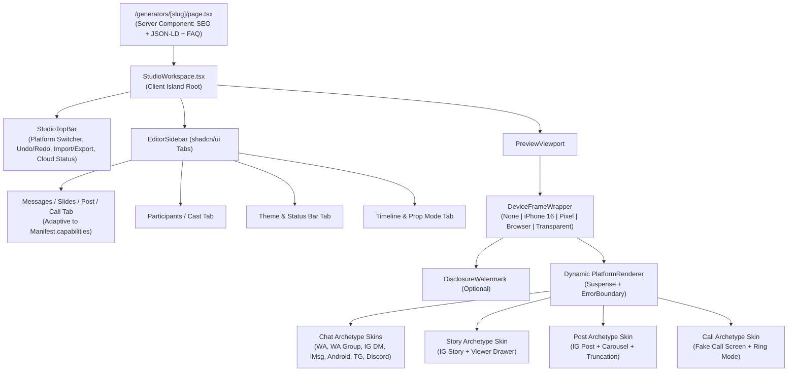

# Component Architecture & Plugin Scalability Guide

**Document Status:** Phase 2 Specification (Pending Approval)  
**UI Stack:** Next.js App Router + React + TypeScript + Tailwind CSS + shadcn/ui + Zustand + Framer Motion

---

## 1. Component Hierarchy Overview

The UI separates **Editor Shell Chrome** (built once with `shadcn/ui`) from **Platform Renderers** (isolated, lazy-loaded visual skins inside `src/platforms/`).



---

## 2. Shared UI Primitives (`src/components/shared-renderers/`)

To ensure adding generator #11 through #50+ requires minimal code, visual primitives that recur across platforms are centralized and styled via injected `PlatformTokenSet` variables:

| Shared Component | Used By | Responsibilities |
|:---|:---|:---|
| `StatusBar.tsx` | All mobile skins | Renders Dynamic Island, Classic Notch, Android Punch-Hole, or Film-Safe Generic bar using `theme.statusBar` (`9:41`, battery %, Wi-Fi, 5G). Automatically hides when `statusBar.visible === false` (presentation mode). |
| `AvatarBadge.tsx` | Chats, Stories, Posts, Calls | Circular/squircle avatar with initials fallback (`avatarFallbackColor`), optional IG story gradient ring, online green dot, and platform-specific `VerificationBadgeType`. |
| `AttachmentRenderer.tsx` | All `chat_thread` skins | Renders `image`, `video_preview`, `audio`, `voice_note`, `gif`, `sticker`, `document`, `location`, and `contact_card` using platform tokens (bubble radius, border, icon set). |
| `VoiceNoteWaveform.tsx` | WA, iMsg, IG DM, TG | Renders deterministic SVG bar waveforms from `voiceNoteMeta.waveformPeaks`, play button, duration label, and listened dot. |
| `ReactionCluster.tsx` | WA, iMsg, IG DM, TG, Discord | Renders Tapbacks (iOS), floating pill reactions (WA/IG), or rectangular counter pills (Discord/TG). |
| `CallEventRow.tsx` | WA, iMsg, TG, Messenger | Renders inline missed/answered/declined voice & video call cards inside a thread. |
| `DeviceFrameWrapper.tsx` | All 4 archetypes | Wraps the canvas in realistic bezels (`iphone_16_pro`, `pixel_9`, `browser_window`) or transparent/card bounds cleanly outside the inner platform DOM so `html-to-image` captures exact pixel ratios. |

---

## 3. Zustand State Architecture (`src/core/store/`)

State is partitioned into focused slices inside a single Zustand store (`useStudioStore`) wrapped with custom `undoRedo` middleware and `indexedDbPersist` subscriber:

```typescript
interface StudioStoreState {
  // Project & Undoable Document Domain (Tracked by Undo/Redo)
  project: Project;

  // Asset Resolution Cache (Runtime ObjectURLs, NOT serialized)
  assetUrls: Record<string, string>;

  // Ephemeral UI State (NOT tracked by Undo/Redo)
  ui: {
    selectedMessageId: string | null;
    activeSidebarTab: 'content' | 'participants' | 'theme' | 'timeline';
    zoomLevel: number;
    isExportModalOpen: boolean;
    isScriptModalOpen: boolean;
    isPlayingPreview: boolean;
    propPlaybackStepIndex: number;
    syncStatus: 'local_only' | 'syncing' | 'synced' | 'conflict' | 'offline';
  };

  // Actions
  actions: {
    switchPlatform: (platformId: string) => void; // Preserves compatible Conversation & Cast!
    addMessage: (msg: Partial<Message>) => void;
    updateMessage: (id: string, patch: Partial<Message>) => void;
    reorderMessages: (fromIndex: number, toIndex: number) => void;
    deleteMessage: (id: string) => void;
    upsertParticipant: (participant: Participant) => void;
    updateTheme: (patch: DeepPartial<PlatformTheme>) => void;
    applyTemplate: (template: Template) => void;
    importScript: (parsed: ParsedScriptResult) => void;
    undo: () => void;
    redo: () => void;
  };
}
```

### Cross-Platform Switching Without Data Loss
Because `Project.conversations` and `Project.cast` use a **platform-agnostic canonical data model**, a user who writes a 20-message conversation in **WhatsApp Chat** can click **"Switch to iMessage"** or **"Switch to Telegram"** and immediately preview/export the exact same dialogue and participants in the new UI—with zero re-typing!

---

## 4. Framer Motion Orchestration

Framer Motion is scoped thoughtfully so static DOM captures stay crisp while live interactions feel fluid:
1. **Editor Micro-Interactions:** Smooth list reordering (`Reorder.Group` / `layout`), collapsible drawers, and instant spring transitions on the live preview when adding/editing messages.
2. **Timeline & Prop Playback Mode:** Animates message entry (`opacity: 0, y: 8 -> opacity: 1, y: 0`), typing indicator dots (`...`), and Call Screen pulse rings.
3. **Export Safety Flag (`disableMotion`):** During `html-to-image` / `html2canvas` static export, Framer Motion transitions settle immediately (or render inside a clean offscreen/cloned static snapshot node) so mid-animation opacity never blurs exported PNGs.

---

## 5. How to Add Generator #11 to #50+ (Zero Core Duplication)

Adding a new generator (for example, **Slack Chat**, **ChatGPT Mockup**, or **TikTok Comment Overlay**) follows a strict **3-step plugin checklist** with **zero edits** to the editor shell, store, export engine, or persistence layer:

1. **Create Platform Folder (`src/platforms/slack-chat/`):**
   - `manifest.ts`: Declare `PlatformCapabilities` (e.g., `archetype: 'chat_thread'`, `supportsGroupChat: true`, `supportsThreads: true`, `supportedMessageTypes: ['text', 'image', 'document', 'code', 'system']`) and SEO metadata.
   - `tokens.ts`: Define Slack light/dark Aubergine palette, typography (`Lato`), and bubble/row spacing.
   - `Renderer.tsx`: Implement the visual Slack message rows using shared `<AvatarBadge />`, `<AttachmentRenderer />`, and `<ReactionCluster />`.
2. **Register in Manifest Index (`src/core/registry/manifests/index.ts`):**
   - Add 1 line importing `slackChatManifest` (metadata only; `Renderer.tsx` stays code-split via `() => import('@/platforms/slack-chat/Renderer')`).
3. **Add SEO Content & Template Seed (`src/content/generators/slack-chat.ts`):**
   - Provide unique instructional steps, 5 platform-specific FAQ entries, and 2–3 starter scenarios so `/generators/slack-chat` automatically generates its static SEO page, `WebApplication` JSON-LD, `FAQPage` schema, and sitemap entry!

> **Result:** Zero duplicated state logic, zero duplicated export code, zero duplicated sidebar forms, and < 15KB added to initial JS bundle regardless of whether the platform hosts 10 generators or 60+.
