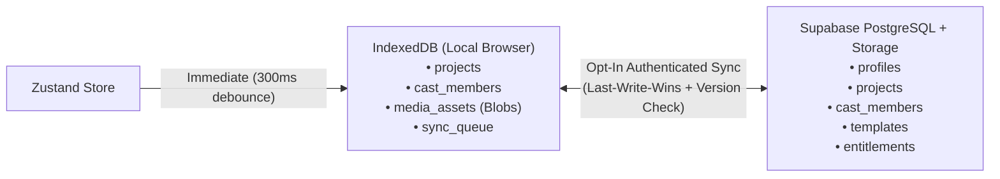
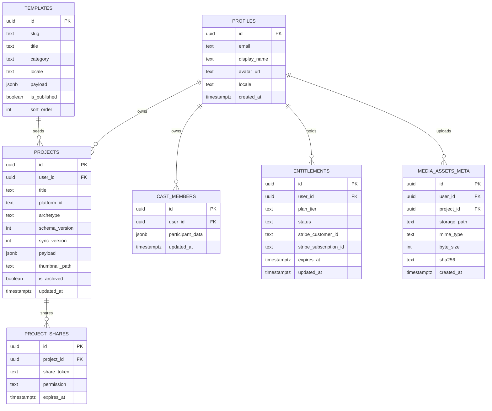

# Database & Local-First Storage Schema

**Document Status:** Phase 2 Specification (Pending Approval)  
**Storage Strategy:** IndexedDB (Primary Local-First) + Supabase PostgreSQL (Strictly Optional Cloud Sync)

---

## 1. Dual-Layer Persistence Philosophy

Phase 1 research showed two opposite failure modes among competitors:
- **Mobile apps (`WhatsMock`) & legacy web utilities (`fakedetail.com`):** Lose all user work on reinstall or tab refresh.
- **Permission-heavy / server-upload apps:** Erode privacy trust by forcing uploads or account walls before export.

Our architecture solves both via **Local-First IndexedDB as the primary database** and **Supabase PostgreSQL strictly as an opt-in cloud sync layer** for authenticated users (Creator Pro, Agency Pro, or multi-device backup).



---

## 2. Layer 1: Browser IndexedDB Schema (`chatforge_local_db`)

Implemented via a typed wrapper (`idb` / `Dexie`) in `src/core/storage/indexedDb.ts`.

### 2.1 Object Stores

| Store Name | Primary Key | Indexes | Purpose |
|:---|:---|:---|:---|
| `projects` | `id` (UUID) | `updatedAt`, `platformId`, `syncStatus` | Full serialized `Project` JSON documents (excluding binary Blob payloads). |
| `cast_members` | `id` (UUID) | `displayName`, `updatedAt` | Global reusable `Participant` library shared across all generators. |
| `media_assets` | `id` (UUID) | `projectId`, `createdAt`, `byteSize` | Binary `Blob` objects for avatars, image attachments, voice note audio, and wallpapers. Keeps JSON lightweight! |
| `preferences` | `key` (string) | — | Active project ID, recent platforms, dismissed banners, keyboard shortcut hints. |
| `sync_queue` | `id` (auto-inc) | `entityType`, `entityId`, `createdAt` | Pending mutations queued while offline for signed-in users. |

### 2.2 Asset Storage & Quota Hygiene
- **Deduplicated Blobs:** When an avatar or image is uploaded, we compute a lightweight SHA-256 hash in WebCrypto, compress/resize oversized images client-side (e.g., max `1080px` width for chat images, `256px` for avatars), and store the `Blob` in `media_assets`.
- **Object URL Lifecycle:** The renderer maps `assetId -> URL.createObjectURL(blob)` in a scoped ref cache and revokes URLs cleanly on project switch to prevent browser memory leaks.
- **Orphan Garbage Collection:** On app idle, any `media_assets` record not referenced by any `projects` or `cast_members` row is pruned automatically to stay well below browser storage limits.

---

## 3. Layer 2: Optional Supabase PostgreSQL Schema

Only used when a user explicitly signs in (`Supabase Auth`) to enable cross-device sync, shared templates, paid passes/subscriptions, or team collaboration.

### 3.1 Entity Relationship Diagram



### 3.2 PostgreSQL DDL (Supabase Migration Spec)

```sql
-- Enable UUID extension
create extension if not exists "pgcrypto";

-- 1. User Profiles (mirrors auth.users)
create table public.profiles (
  id uuid primary key references auth.users(id) on delete cascade,
  email text not null,
  display_name text,
  avatar_url text,
  preferred_locale text not null default 'en',
  created_at timestamptz not null default now(),
  updated_at timestamptz not null default now()
);

-- 2. Billing & Plan Entitlements (7-Day Pass, Creator Pro, Agency Pro, Lifetime)
create table public.entitlements (
  id uuid primary key default gen_random_uuid(),
  user_id uuid not null references public.profiles(id) on delete cascade,
  plan_tier text not null check (plan_tier in ('free', 'pass_7d', 'creator_pro', 'agency_pro', 'lifetime')),
  status text not null check (status in ('active', 'trialing', 'past_due', 'canceled', 'expired')),
  stripe_customer_id text,
  stripe_subscription_id text,
  stripe_checkout_session_id text,
  current_period_end timestamptz,
  ai_credits_remaining int not null default 3,
  created_at timestamptz not null default now(),
  updated_at timestamptz not null default now(),
  unique (user_id)
);

-- 3. Cloud-Synced Projects
create table public.projects (
  id uuid primary key default gen_random_uuid(),
  user_id uuid not null references public.profiles(id) on delete cascade,
  title text not null default 'Untitled Mockup',
  platform_id text not null,
  archetype text not null check (archetype in ('chat_thread', 'ephemeral_story', 'social_post', 'call_screen')),
  schema_version int not null default 1,
  sync_version int not null default 1,
  payload jsonb not null, -- Validated Project JSON (conversations, theme, timeline, exportSettings)
  is_archived boolean not null default false,
  created_at timestamptz not null default now(),
  updated_at timestamptz not null default now(),
  deleted_at timestamptz -- Soft delete for multi-device sync tombstones
);

create index idx_projects_user_updated on public.projects (user_id, updated_at desc) where deleted_at is null;
create index idx_projects_platform on public.projects (platform_id);

-- 4. Reusable Cast of Characters Library
create table public.cast_members (
  id uuid primary key default gen_random_uuid(),
  user_id uuid not null references public.profiles(id) on delete cascade,
  display_name text not null,
  participant_data jsonb not null, -- Participant TypeScript model
  created_at timestamptz not null default now(),
  updated_at timestamptz not null default now(),
  deleted_at timestamptz
);

create index idx_cast_user on public.cast_members (user_id, updated_at desc) where deleted_at is null;

-- 5. Synced Media Asset Metadata (binaries live in private Supabase Storage bucket)
create table public.media_assets_meta (
  id uuid primary key,
  user_id uuid not null references public.profiles(id) on delete cascade,
  project_id uuid references public.projects(id) on delete set null,
  storage_path text not null, -- e.g. '<user_id>/<asset_id>.webp'
  mime_type text not null,
  byte_size int not null check (byte_size > 0 and byte_size <= 10485760), -- 10MB cap
  sha256 text not null,
  created_at timestamptz not null default now()
);

create index idx_media_user_sha on public.media_assets_meta (user_id, sha256);

-- 6. Curated Public Starter Templates
create table public.templates (
  id uuid primary key default gen_random_uuid(),
  slug text not null unique,
  title text not null,
  category text not null,
  locale text not null default 'en',
  supported_archetypes text[] not null,
  recommended_platform_ids text[] not null,
  payload jsonb not null,
  is_published boolean not null default true,
  sort_order int not null default 100,
  created_at timestamptz not null default now()
);

create index idx_templates_published on public.templates (is_published, category, sort_order);

-- 7. Read-Only / Client Review Share Links (Phase 4 Agency Feature)
create table public.project_shares (
  id uuid primary key default gen_random_uuid(),
  project_id uuid not null references public.projects(id) on delete cascade,
  created_by uuid not null references public.profiles(id) on delete cascade,
  share_token text not null unique,
  permission text not null check (permission in ('view_only', 'approve_comment')),
  expires_at timestamptz,
  created_at timestamptz not null default now()
);

-- 8. AI Usage & Audit Log (Rate limiting + Abuse prevention)
create table public.ai_generation_logs (
  id uuid primary key default gen_random_uuid(),
  user_id uuid references public.profiles(id) on delete set null,
  ip_hash text,
  platform_id text not null,
  tokens_used int not null default 0,
  created_at timestamptz not null default now()
);
```

### 3.3 Row Level Security (RLS) Policies

Every user-owned table enforces strict RLS so zero cross-tenant leakage is possible:

```sql
alter table public.profiles enable row level security;
alter table public.entitlements enable row level security;
alter table public.projects enable row level security;
alter table public.cast_members enable row level security;
alter table public.media_assets_meta enable row level security;
alter table public.templates enable row level security;
alter table public.project_shares enable row level security;

-- Profiles: users read/update only their own row
create policy "profiles_self_access" on public.profiles
  for all using (auth.uid() = id) with check (auth.uid() = id);

-- Entitlements: users can read own plan; mutations performed strictly via Service Role (Stripe webhook)
create policy "entitlements_read_own" on public.entitlements
  for select using (auth.uid() = user_id);

-- Projects: strict owner CRUD
create policy "projects_owner_all" on public.projects
  for all using (auth.uid() = user_id) with check (auth.uid() = user_id);

-- Cast Members: strict owner CRUD
create policy "cast_owner_all" on public.cast_members
  for all using (auth.uid() = user_id) with check (auth.uid() = user_id);

-- Media Assets: strict owner CRUD
create policy "media_owner_all" on public.media_assets_meta
  for all using (auth.uid() = user_id) with check (auth.uid() = user_id);

-- Templates: publicly readable when published
create policy "templates_public_read" on public.templates
  for select using (is_published = true);

-- Project Shares: owner manages; public token lookup via dedicated RPC/Edge route
create policy "shares_owner_manage" on public.project_shares
  for all using (auth.uid() = created_by) with check (auth.uid() = created_by);
```

### 3.4 Supabase Storage Buckets
- **`user-assets` (Private Bucket):**
  - Path pattern: `{user_id}/{asset_id}.{ext}`
  - RLS policy: `storage.foldername(name)[1] = auth.uid()::text`
  - Accessed via short-lived signed URLs (`1 hour` TTL) when hydrating a cloud project onto a second device.
- **Privacy Note:** Only uploaded avatars/custom chat media are synced if the user signs in and turns on Cloud Sync. Anonymous users never touch Supabase Storage at all.
