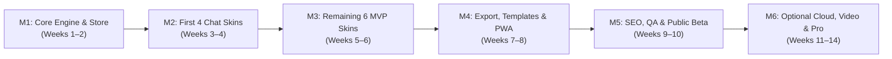

# Feature Roadmap & Implementation Milestones

**Document Status:** Phase 2 Specification (Pending Approval)  
**MVP Scope:** 10 Core Generators + Shared Studio Engine  
**Long-Term Horizon:** 50+ Generators Across 5 Expansion Waves

---

## 1. MVP Scope: The 10 Prioritized Generators

Per Prompt 02 prioritization, Phase 1 (MVP) focuses on the following **10 initial generators** built on top of the shared 4-archetype generator engine:

| # | Generator | URL Slug | UI Archetype | Key Platform-Specific Capabilities |
|:---|:---|:---|:---|:---|
| 1 | **WhatsApp Chat Generator** | `/generators/whatsapp-chat` | `chat_thread` | Single/double/blue ticks, voice notes with waveforms, forwarded tags, link previews, custom wallpaper, iOS vs Android switch, light/dark mode |
| 2 | **WhatsApp Group Chat Generator** | `/generators/whatsapp-group-chat` | `chat_thread` | Unlimited participants with auto-colored sender names, reply-to-quote bubbles, typing collisions, system events, group polls, admin badges |
| 3 | **Instagram DM Generator** | `/generators/instagram-dm` | `chat_thread` | Purple-blue gradient outgoing bubbles, story reply cards, shared post/reel previews, voice pills, vanish mode toggle, "Seen" indicator, heart reactions |
| 4 | **Instagram Story Generator** | `/generators/instagram-story` | `ephemeral_story` | Multi-slide 9:16 story progress bars, custom background media, interactive sticker previews (poll, question box, music, link, mention), viewer count & viewer list sheet |
| 5 | **Instagram Post Generator** | `/generators/instagram-post` | `social_post` | Verified/standard header, 1:1 / 4:5 / carousel media preview, accurate `...more` caption truncation toggle, like/comment/share/bookmark counts, nested comment preview |
| 6 | **iMessage Generator** | `/generators/imessage` | `chat_thread` | Blue iMessage vs green SMS bubble toggle, iOS Tapbacks (`❤️`, `👍`, `👎`, `HaHa`, `!!`, `?`), Delivered/Read receipts, Dynamic Island/notch bar, dark/light mode |
| 7 | **Android Messages Generator** | `/generators/android-messages` | `chat_thread` | Material You RCS vs SMS bubble styling, Android status bar (punch-hole, battery, 5G), RCS "Read" checkmarks, emoji reactions, dark/light theme |
| 8 | **Telegram Chat Generator** | `/generators/telegram-chat` | `chat_thread` | Desktop/Mobile/iOS-Android styles, single/double checkmarks, custom patterned wallpapers, reply quotes, bot/channel labels, voice notes, document cards |
| 9 | **Discord Chat Generator** | `/generators/discord-chat` | `chat_thread` | Dark/Midnight/Light themes, server channel header (`#general`), colored role names, `APP`/`BOT` tags, message grouping, inline embeds, reaction counter pills |
| 10 | **Fake Call Screen Generator** | `/generators/fake-call-screen` | `call_screen` | Multi-skin (iOS Incoming/Active, FaceTime, WhatsApp Voice/Video, Instagram Video), custom caller photo/wallpaper, mute/speaker toggles, Static PNG + Live Ring Simulator mode |

### MVP Shared Platform Features (Included Across All 10)
- **Watermark-Free Client-Side Exports:** HD PNG (`1x`/`2x`/`3x`/`4x`), JPEG, WebP, Full-Height Long Conversation PNG, Semantic HTML/CSS snippet, and Printable Monochrome PDF.
- **All 12+ Rich Message & Attachment Types** (filtered declaratively per platform `manifest.capabilities`).
- **Local-First IndexedDB Persistence:** Instant auto-save & restore across browser sessions, plus `.chatforge.json` project file import/export.
- **Undo / Redo:** 50-step history stack with keyboard shortcuts (`Cmd/Ctrl+Z`, `Cmd/Ctrl+Shift+Z`).
- **Productivity Accelerators:** `Name: Message` screenplay bulk script-paste parser + 3–5 starter templates per generator + reusable local Cast of Characters.
- **PWA Support:** Installable web app with offline editing and static PNG export.

---

## 2. MVP Implementation Milestones

| Milestone | Target Window | Key Deliverables | Exit Criteria |
|:---|:---|:---|:---|
| **M1: Foundation & Shared Engine** | Weeks 1–2 | Next.js 15 App Router scaffold, TypeScript types (`src/core/types/`), Platform Registry, Zustand store + Undo/Redo middleware, IndexedDB adapter, `shadcn/ui` Studio shell, `StatusBar`/`DeviceFrameWrapper` | Unit tests pass for store, undo/redo, and IndexedDB persistence; shell renders cleanly with mock plugin |
| **M2: Messaging Core (First 4)** | Weeks 3–4 | WhatsApp Chat, WhatsApp Group Chat, iMessage, Android Messages renderers + all 12 message/attachment primitives (`AttachmentRenderer`, `VoiceNoteWaveform`, `ReactionCluster`) | Pixel-accuracy check against iOS 18 & Android 15 references; full PNG export passes E2E |
| **M3: Social, Story, Call & Community (Next 6)** | Weeks 5–6 | Instagram DM, Instagram Story (`ephemeral_story`), Instagram Post (`social_post`), Telegram Chat, Discord Chat, Fake Call Screen (`call_screen`) | All 10 MVP generators registered in `src/core/registry/`; zero core shell duplication |
| **M4: Power Tools, Export & PWA** | Weeks 7–8 | Script-paste bulk parser, Template Engine + starter library, `.chatforge.json` import/export, Carousel ZIP / HTML / PDF exporters, `next-pwa` Service Worker & offline mode | Offline E2E test passes; screenplay import creates multi-speaker group chat cleanly |
| **M5: SEO, Accessibility & Launch QA** | Weeks 9–10 | SSG/ISR pages for all 10 generators, JSON-LD (`WebApplication`, `FAQPage`, `HowTo`, `BreadcrumbList`), E-E-A-T trust articles, Playwright visual regression & Lighthouse CI gates | Lighthouse Performance ≥ 90, Accessibility ≥ 95, SEO ≥ 95, CLS < 0.05; Beta launch |
| **M6: Optional Cloud, Video & Monetization** | Weeks 11–14 | Opt-in Supabase Auth + cloud project/Cast sync, client-side MP4 Animated Video Export (9:16/4:5/1:1), Prop Playback Mode, AI Script API, Stripe (7-Day Pass + Creator Pro) | Sync conflict resolution & Stripe webhook tests pass; video exports cleanly in Chromium |

---

## 3. Future Generators Roadmap (Planned Separately — Scaling to 50+)

Because every generator plugs into one of our **4 UI Archetypes** via `manifest.ts` + `tokens.ts` + `Renderer.tsx`, expansion waves require minimal engineering overhead and zero core rewrites:

### Wave 2 — High-ROI SEO & B2B Blue Oceans (Generators #11–22)
- **AI Chat Mockups (`chat_thread`):** ChatGPT, Claude, Gemini, Perplexity, Grok (with Markdown + syntax-highlighted code blocks & thinking badges — lowest SERP competition identified in Phase 1).
- **Social Feed & Comment Overlays (`social_post`):** Twitter/X Post & Thread, TikTok Comment Overlay (Transparent PNG for CapCut), YouTube Comment Overlay (Transparent PNG), Facebook Post & Ad Mockup, Reddit Post & Nested Thread, LinkedIn Post, Meta Threads Post.
- **Messaging Gaps:** Facebook Messenger, Snapchat Chat.

### Wave 3 — Workplace, Context Surfaces & Dating (Generators #23–34)
- **B2B Workspace Chats (`chat_thread`):** Slack Channel/Thread, Microsoft Teams Chat, Intercom/Zendesk Support Widget, Gmail/Apple Mail Thread.
- **Adjacent Context Surfaces (`call_screen` / `chat_thread`):** iOS Lock Screen Notifications (multi-app including IG, WhatsApp, Discord, Slack — *excluding bank/payment receipts*), WhatsApp/Instagram Inbox Chat List, TikTok Live / IG Live Stream Overlay, WhatsApp Status & Viewer List.
- **Dating & Social Discovery:** Tinder Chat/Match, Hinge Profile/Prompt, Bumble Chat.

### Wave 4 — Filmmaker, Fiction & Regional Markets (Generators #35–46)
- **Regional Asian Messengers (Low SERP Competition):** LINE Chat (Japan/Thailand/Taiwan), KakaoTalk (South Korea), WeChat (China/Diaspora), Signal (Privacy/OSINT).
- **Creator & Storyteller Specialties:** Film-Safe Generic Messenger (zero Apple/Meta trademarks), Retro Nokia 3310 SMS, Classic AIM / MSN Messenger, Printer-Friendly B&W RPG Transcript, Bluesky Post.

### Wave 5 — International Localization & Developer Scale (47–50+ & API)
- **Localized Generator Hubs:** `/es/` (Spanish), `/pt/` (Portuguese-BR), `/id/` (Indonesian), `/de/` (German), `/fr/` (French), `/hi/` (Hindi), `/tr/` (Turkish), `/ar/` (Arabic with native RTL mirroring).
- **Programmatic Render API & Agency Suite:** Headless render endpoints, no-login client review approval links, brand kits, and multi-speaker AI TTS + split-screen video composition.
