# SEO Keyword Research & Search Intent Blueprint: Social Media Chat & Mockup Generator

**Prepared By:** Senior Technical & Content SEO Specialist  
**Research Date:** November 25, 2026  
**Target Product:** Social Media Chat & Mockup Generator (New Web SaaS)  
**Primary Workspace Output:** `/Users/vaibhavborkar/chat generator/docs/research/keyword-research.md`

---

> [!IMPORTANT]
> **Methodology & Metric Disclosure (Strict Evidence Standard)**
> All competitive intelligence, domain rankings, SERP split-intent patterns, and feature analyses in this document are directly verified via live Google search grounding (`search_web`) conducted on November 25, 2026. Because this research environment does not have live API access to third-party SEO databases (Ahrefs, Semrush, Google Ads Keyword Planner) or raw un-rendered Google SERP HTML DOMs:
> 1. **Zero search volume or Keyword Difficulty (KD) numbers are fabricated.**
> 2. All Search Volume Tiers and Competition Levels are explicitly tagged as **`UNVERIFIED ESTIMATE`** and derived transparently from observable SERP competition signals (e.g., density of dedicated single-purpose domains, mobile app store pack competition, SaaS giant presence, YouTube tutorial saturation, and multi-language indexation).
> 3. **People Also Ask (PAA)** and **Related Searches** distinguish clearly between **Observed Question/Intent Evidence** (verified via targeted question and Reddit/YouTube searches) and **Inferred SERP Modifiers (`UNVERIFIED SERP BOX`)**.

---

## 1. Executive Summary

### 1.1 Market SEO Landscape
The search market for fake chat and social media mockup tools is **highly active, fragmented by user persona, and characterized by severe UX dissatisfaction among legacy winners**. Across 35+ live search queries covering messaging platforms, social feeds, video storytelling, B2B presentations, and non-English queries, four distinct search ecosystems emerge:

1. **Consumer / Meme / Storytelling Fake Chat Generators (Highest Volume, Legacy UX Debt):**
   - Queries like `fake whatsapp chat generator`, `fake text message generator`, and `fake iphone text generator` are dominated by ad-heavy legacy web utilities (**Zeoob** [`zeoob.com`], **FakeDetail** [`fakedetail.com`], **PrankShit** [`prankshit.com`], **iFakeTextMessage** [`ifaketextmessage.com`]), developer utility suites (**10015 Tools** [`10015.io`]), and Google Play / Apple App Store listings (**ChatsMock**, **WhatsFake**, **iFake**, **TextingStory**).
   - **Critical Vulnerability Found via Reddit Research:** Users on Reddit (`r/SideProject`, `r/microsaas`, `r/vibecoding`) consistently complain about top-ranking incumbents forcing intrusive display ads, bait-and-switch watermarks/paywalls at the download screen, outdated iOS/Android UI details, lack of full scrolling exports, and privacy fears around server uploads. Indie challengers like **FauxTalks** (`fauxtalks.com`), **TheFake** (`thefake.design`), and **GreenTick** (`greentick.ai`) are actively winning organic word-of-mouth by positioning around *"100% client-side, no ads, no watermark"*.

2. **B2B Marketing, Agency & UI Presentation Mockups (High Commercial Value, Product-Led SEO):**
   - Queries like `social media mockup generator`, `social media post mockup tool`, `facebook post generator mockup`, and `chat mockup for presentation` serve performance marketers, social media agencies, and SaaS founders.
   - Strong SaaS competitors capture this traffic via free lead-magnet tools: **Adpiler** (`adpiler.com`), **Mockupduck** (`mockupduck.com`), **AdSights** (`adsights.ai`), **CommonNinja** (`commoninja.com`), **Whautomate** (`whautomate.com`), **Rotato** (`rotato.app`), **Canva** (`canva.com`), **Placeit** (`placeit.net`), and **Mockey AI** (`mockey.ai`).
   - **Mockly** (`getmockly.com`) is the fastest-evolving multi-modal challenger observed, bridging static mockups, 3D rotating video exports, AI chat mockups (ChatGPT/Claude/Gemini/Grok/Perplexity), and a `$99/month` developer **Mockup Render API**.

3. **Short-Form "Texting Story" Video Makers (High Monetization & Creator Demand):**
   - Queries like `fake chat video maker` and `how to make fake text message story video tiktok youtube shorts` represent the fastest-growing commercial wedge (TikTok, YouTube Shorts, Instagram Reels faceless channels).
   - Competitors monetize aggressively here: **texting.video**, **Crayo AI** (`crayo.ai`), **AutoReels.AI** (`autoreels.ai`), **FlickifyAI** (`flickifyai.com`), **ChatAnimate** (`chat-animate.com`), **Malloy Studio** (`malloystudio.ai`), **Breakout Clips** (`breakoutclips.com`), **MakeViral.ai** (`makeviral.ai`), and **TextingStory**.

4. **Severe Keyword Intent Splits (Anti-Cannibalization Alert):**
   - Several seemingly obvious target keywords actually trigger **split or non-mockup SERPs**:
     - `twitter post generator` -> Splits between **AI tweet writers** (`Copy.ai`, `SocialPilot`, `Typefully`, `Easy-Peasy.AI`) and visual mockup tools (`Tweetgen`, `Tweet AI`, `Zeoob`).
     - `tiktok comment generator` -> Splits between **AI comment text writers** (`Planable`, `Bolta.ai`, `Kontentino`, `Trickle`) and **transparent PNG comment overlay makers** for CapCut/Premiere (`Mimicly`, `TokCommentGenerator`, `Postfully`, `OneUp`).
     - `instagram dm generator online` -> Splits between fake DM screenshot tools (`10015.io`, `Zeoob`, `Mockly`) and **real `ig.me` click-to-chat link generators** (`Vaizle`).
     - `instagram story generator` & `whatsapp status generator` -> Heavily dominated by **real graphic design/AI art suites** (`Canva`, `Adobe Express`, `Picsart`, `Piktochart`, `NightCafe`, `Flixier`) rather than mockup screenshot simulators.
     - `whatsapp group chat generator` -> Splits between fake group chat makers and tutorials for generating real `chat.whatsapp.com` invite links.

### 1.2 Strategic SEO Thesis for Our New Product
To rank rapidly without fighting Canva/Hootsuite head-on in Month 1:
- **Lead with Transactional Simulator Disambiguation:** Target explicit mockup/screenshot modifiers (`fake`, `mockup`, `screenshot maker`, `overlay`, `without watermark`) rather than ambiguous nouns like `instagram story generator` or `twitter post generator`.
- **Win on Product-Led SEO & UX Differentiation:** Make every tool page 100% client-side, instant-load, watermark-free on base PNG exports, pixel-accurate (iOS 18/Android toggles, dark mode, voice waveforms, blue ticks), and visibly privacy-first.
- **Capture Blue-Ocean Verticals Early:** AI Chat Mockups (`ChatGPT`, `Claude`, `Gemini`), B2B Workspace Chats (`Slack`, `Discord`, `Microsoft Teams`), Comment Overlays (`TikTok`, `YouTube`, `Reddit threads`), and localized non-English pages (Spanish, Portuguese, Indonesian, Hindi, French, German) where English sites currently rank by default.

---

## 2. Keyword Universe Table

> **Legend:** All `Competition` and `Est. Volume` ratings below are **`UNVERIFIED ESTIMATE`** derived from SERP competitor density, domain authority diversity, App Store competition, and cross-market footprint observed in live web search outputs.

| Keyword | Search Intent | Competition (`UNVERIFIED ESTIMATE`) | Est. Volume (`UNVERIFIED ESTIMATE`) | Recommended URL | Content Type | Priority |
| :--- | :--- | :--- | :--- | :--- | :--- | :--- |
| `fake whatsapp chat generator` | Transactional | High | Very High (Core Head Term) | `/generators/whatsapp-chat` | Interactive Web Tool + How-To/FAQ | P0 |
| `fake text message generator` | Transactional | High | Very High (Core Head Term) | `/generators/text-message` | Interactive Web Tool (SMS/iMessage) | P0 |
| `fake iphone text generator` | Transactional | High | High | `/generators/iphone-imessage` | Interactive Web Tool (iOS UI) | P0 |
| `whatsapp chat screenshot maker` | Transactional | Medium-High | High | `/generators/whatsapp-chat` (variant/H2/FAQ target) | Interactive Web Tool + Template Presets | P0 |
| `instagram dm generator online` | Transactional (Split Intent) | Medium-High | High | `/generators/instagram-dm` | Interactive Web Tool (Mockup vs `ig.me` clarity) | P0 |
| `fake tweet generator` / `twitter post mockup generator` | Transactional (Disambiguated) | Medium-High | High | `/generators/twitter-post` | Interactive Web Tool (Tweet + Reply Thread) | P0 |
| `messenger chat generator` | Transactional | Medium | Medium-High | `/generators/messenger-chat` | Interactive Web Tool | P1 |
| `telegram chat generator` | Transactional | Medium | Medium-High | `/generators/telegram-chat` | Interactive Web Tool | P1 |
| `fake snapchat generator` | Transactional | Medium | Medium-High | `/generators/snapchat-chat` | Interactive Web Tool | P1 |
| `whatsapp group chat generator` | Transactional (Split Intent) | Medium | Medium | `/generators/whatsapp-group-chat` | Interactive Multi-Participant Tool | P1 |
| `fake chat video maker` | Transactional / Commercial | Medium-High | High (Growing) | `/video-maker` | Animated Chat-to-MP4 Tool + Landing Page | P0 |
| `tiktok comment generator` (visual overlay) | Transactional (Split Intent) | Medium | Medium-High | `/generators/tiktok-comment-overlay` | Transparent PNG Sticker Tool | P1 |
| `facebook post generator mockup` | Transactional / Commercial | Medium-High | Medium | `/generators/facebook-post-mockup` | Interactive Ad & Organic Post Tool | P1 |
| `social media mockup generator` | Commercial / Transactional | Very High (B2B SaaS) | High | `/social-media-mockups` | Multi-Platform Hub + Interactive Workspace | P1 |
| `social media post mockup tool` | Commercial / Transactional | High (B2B SaaS) | Medium | `/social-media-mockups` | Hub Page + Client Preview Feature | P2 |
| `fake notification generator` | Transactional | Medium | Medium | `/generators/lock-screen-notification` | Interactive iOS/Android Notification Tool | P1 |
| `fake call screen generator` | Transactional | Medium | Medium | `/generators/fake-call-screen` | Interactive Call Mockup + Ring Simulator | P2 |
| `chat mockup for presentation` | Commercial / Informational | Low-Medium | Low-Medium (High B2B Value) | `/use-cases/presentation-chat-mockups` | Use-Case Landing Page + Clean Export Tool | P1 |
| `fake instagram story mockup generator` *(disambiguated)* | Transactional | Medium | Medium | `/generators/instagram-story` | Interactive 9:16 Story Mockup Tool | P2 |
| `fake whatsapp status generator` *(disambiguated)* | Transactional | Low-Medium | Low-Medium | `/generators/whatsapp-status` | Interactive Status & Viewer List Tool | P2 |
| `instagram story generator` *(broad head term)* | Mixed (Design/AI Art) | Very High (Canva/Picsart) | Very High | `/generators/instagram-story` (secondary only) | Defer — Target `"mockup"` modifier first | P3 |
| `whatsapp status generator` *(broad head term)* | Mixed (Flyers/Video) | Very High (Canva/Adobe) | High | `/generators/whatsapp-status` (secondary only) | Defer — Target `"fake"`/`"viewer"` modifiers | P3 |
| `twitter post generator` *(broad head term)* | Mixed (AI Copy vs Mockup) | Very High (Copy.ai/Hootsuite) | High | `/generators/twitter-post` (secondary) | Disambiguate via `"mockup"` / `"fake"` | P2 |
| `best fake chat app free` | Commercial Investigation | High (Play/App Store) | High | `/compare/best-fake-chat-apps-vs-web` | Comparison Listicle + No-Download CTA | P1 |
| `social media mockup tools comparison` | Commercial Investigation | Medium-High | Low-Medium | `/compare/social-media-mockup-tools` | B2B Comparison Matrix & Guide | P2 |
| `fake discord chat generator` | Transactional | Low-Medium | Medium | `/generators/discord-chat` | Interactive Tool (Roles, Reactions, Dark UI) | P1 |
| `slack chat mockup generator` | Transactional / B2B | Low | Low-Medium (High B2B LTV) | `/generators/slack-chat` | Interactive B2B Workspace Chat Tool | P1 |
| `ai chat screenshot generator` (ChatGPT/Claude) | Transactional | Low | Emerging / Growing | `/generators/ai-chat-mockup` | Interactive Markdown-to-UI Mockup Tool | P0 |
| `reddit post and comment mockup generator` | Transactional | Low-Medium | Medium | `/generators/reddit-post-mockup` | Interactive Post + Nested Thread Tool | P1 |
| `youtube comment generator` | Transactional | Low-Medium | Medium | `/generators/youtube-comment` | Transparent PNG Overlay + Reply Thread Tool | P1 |
| `fake tinder chat generator` / `hinge profile mockup` | Transactional | Low-Medium | Medium | `/generators/dating-chat-mockup` | Interactive Dating UI Mockup Tool | P2 |
| `linkedin post mockup generator` | Commercial / B2B | Medium | Medium | `/generators/linkedin-post` | Interactive B2B Feed Preview Tool | P2 |
| `threads post mockup generator` | Transactional | Low | Low-Medium | `/generators/threads-post` | Interactive Meta Threads Mockup Tool | P2 |
| `fake chat generator without watermark` | Transactional | Low-Medium | Medium-High | `/features/no-watermark` + Global USP | USP Landing Page + Embedded Tool | P0 |
| `how to tell if a whatsapp screenshot is fake` | Informational | Low-Medium | Medium-High | `/blog/how-to-spot-fake-whatsapp-screenshots` | Forensic/Educational Guide + Trust Anchor | P1 |
| `are fake chat generators legal` | Informational | Low | Medium | `/blog/are-fake-chat-generators-legal-and-safe` | Trust/Compliance Guide + FAQ | P1 |
| `how to make fake text story video for tiktok` | Informational / Tutorial | Medium | High | `/blog/how-to-make-texting-story-videos` | Step-by-Step Tutorial + Video Maker CTA | P1 |

---

## 3. Detailed Keyword & SERP Intelligence (All 23 Core Queries + Niche Clusters)

Below is the granular analysis of every required query, grounded directly in `search_web` evidence from November 25, 2026.

### Query 1: `fake whatsapp chat generator`
- **Primary Keyword:** `fake whatsapp chat generator`
- **Search Intent:** Transactional (immediate browser tool usage or app install).
- **Top Ranking Competitors Observed:** `zeoob.com`, `10015.io`, `getmimic.lol`, `getmockly.com`, `edesy.in`, `softonic.com`, and Google Play Store (`ChatsMock / Fake Chat Maker`).
- **People Also Ask / User Questions:**
  - *Observed via Search/Reddit/Legal queries:* "Are fake WhatsApp chat generators legal and safe to use?", "Do fake chat generators leave watermarks?", "Can fake chat generators hack or connect to real WhatsApp accounts?"
  - *Inferred PAA (`UNVERIFIED SERP BOX`):* "How do I create a fake WhatsApp conversation?", "Which app is best for fake WhatsApp chat?", "How can you tell if a WhatsApp chat is fake?"
- **Related Searches (`UNVERIFIED SERP BOX` / Observed Modifiers):** `fake whatsapp chat generator online`, `fake whatsapp chat generator without watermark`, `whatsapp chat screenshot maker`, `fake whatsapp group chat generator`, `whatsmock`.
- **Content Type That Ranks:** Interactive single-page web tool pages (with embedded live preview + SEO instructions below the fold), Google Play Store listings, and software download directories (Softonic).
- **Competition Level (`UNVERIFIED ESTIMATE`):** High (crowded by entrenched single-purpose tool pages + Android app packs).
- **Search Volume (`UNVERIFIED ESTIMATE`):** Very High (Category anchor query; multi-language equivalents rank worldwide).
- **Recommended Target URL:** `/generators/whatsapp-chat`
- **Citations:** Search results for `"fake whatsapp chat generator"` (`zeoob.com`, `10015.io`, `getmimic.lol`, `getmockly.com`, `edesy.in`, `softonic.com`, `google.com`).

### Query 2: `instagram dm generator online`
- **Primary Keyword:** `instagram dm generator online`
- **Search Intent:** Transactional, with **Intent Ambiguity** between fake DM screenshot tools and real click-to-DM URL generators (`ig.me/m/username`).
- **Top Ranking Competitors Observed:** `10015.io`, `zeoob.com`, `fakemess.com`, `mimicpost.com`, `getmockly.com`, and `vaizle.com` (click-to-chat URL generator).
- **People Also Ask / User Questions:**
  - *Observed:* "What is the difference between an Instagram DM screenshot mockup and an `ig.me` DM link?"
  - *Inferred PAA (`UNVERIFIED SERP BOX`):* "How to fake an Instagram DM screenshot?", "Can you create fake Instagram DMs in dark mode?", "Is there a free Instagram DM generator with no watermark?"
- **Related Searches (`UNVERIFIED SERP BOX` / Observed Modifiers):** `fake instagram dm generator`, `instagram chat generator`, `instagram dm mockup online free`, `ig.me link generator`.
- **Content Type That Ranks:** Browser-based tool pages (mockup generators and link tools).
- **Competition Level (`UNVERIFIED ESTIMATE`):** Medium-High.
- **Search Volume (`UNVERIFIED ESTIMATE`):** High.
- **Recommended Target URL:** `/generators/instagram-dm` (Explicitly state *"Fake Instagram DM Screenshot Mockup"* in Title/H1 to win mockup clicks and filter out `ig.me` link-builders, or include a mini `ig.me` link helper box as a bonus utility).
- **Citations:** Search results for `"instagram dm generator online"` (`10015.io`, `zeoob.com`, `fakemess.com`, `mimicpost.com`, `getmockly.com`, `vaizle.com`).

### Query 3: `fake text message generator`
- **Primary Keyword:** `fake text message generator`
- **Search Intent:** Transactional.
- **Top Ranking Competitors Observed:** `ifaketextmessage.com`, `thefake.design`, `zeoob.com`, `addspeechbubble.com`, and Google Play (`Text Message Creator` / `Fake Chat Maker`).
- **People Also Ask / User Questions:**
  - *Observed via Video/Reddit queries:* "How do creators make fake text message stories for TikTok?", "Can I switch between blue iMessage and green SMS bubbles?"
  - *Inferred PAA (`UNVERIFIED SERP BOX`):* "How to make fake text messages on iPhone?", "What is the best fake text message generator?"
- **Related Searches (`UNVERIFIED SERP BOX`):** `ifaketextmessage`, `fake sms generator`, `fake text generator iPhone`, `fake text story video maker`.
- **Content Type That Ranks:** Interactive web tools (`iFakeTextMessage`), multi-platform hubs (`TheFake`, `Zeoob`), and Play Store apps.
- **Competition Level (`UNVERIFIED ESTIMATE`):** High.
- **Search Volume (`UNVERIFIED ESTIMATE`):** Very High.
- **Recommended Target URL:** `/generators/text-message`
- **Citations:** Search results for `"fake text message generator"` (`ifaketextmessage.com`, `thefake.design`, `zeoob.com`, `addspeechbubble.com`, `google.com`).

### Query 4: `social media mockup generator`
- **Primary Keyword:** `social media mockup generator`
- **Search Intent:** Commercial / Transactional (B2B agency, designer, and brand marketer persona).
- **Top Ranking Competitors Observed:** `adpiler.com`, `screenhance.com`, `rotato.app`, `placeit.net`, `canva.com`, `renderforest.com`, `goodmockups.com`, plus comparison blogs (`agencyvista.com`, `thinkmaverick.com`, `postonce.to`).
- **People Also Ask / User Questions:**
  - *Observed:* "How do agencies preview social ads and carousels for client approval without sending flat PDFs?"
  - *Inferred PAA (`UNVERIFIED SERP BOX`):* "What is the best free social media mockup generator?", "Can Canva make realistic social media post mockups?", "Where can I download social media PSD mockups?"
- **Related Searches (`UNVERIFIED SERP BOX`):** `social media post mockup`, `free social media ad mockup generator`, `social media mockup psd`, `client approval mockup tool`.
- **Content Type That Ranks:** SaaS product landing pages (`Adpiler`, `Screenhance`, `Placeit`, `Canva`), 3D/PSD download libraries (`Rotato`, `GoodMockups`), and B2B tool listicles.
- **Competition Level (`UNVERIFIED ESTIMATE`):** Very High (competing directly against high-DR SaaS brands like Canva, Placeit, Renderforest).
- **Search Volume (`UNVERIFIED ESTIMATE`):** High.
- **Recommended Target URL:** `/social-media-mockups` (Category hub linking down to individual B2B post/ad generators).
- **Citations:** Search results for `"social media mockup generator"` (`adpiler.com`, `screenhance.com`, `rotato.app`, `placeit.net`, `canva.com`, `renderforest.com`, `goodmockups.com`).

### Query 5: `whatsapp chat screenshot maker`
- **Primary Keyword:** `whatsapp chat screenshot maker`
- **Search Intent:** Transactional (leans slightly more toward clean marketing/tutorial screenshots vs "prank").
- **Top Ranking Competitors Observed:** `whautomate.com`, `commoninja.com`, `zeoob.com`, `fakechatapp.com`, `softonic.com`, `promptbase.com`.
- **People Also Ask / User Questions:**
  - *Observed:* "What elements can I customize in a WhatsApp mockup (online/typing status, single/double/blue ticks, iOS vs Android)?"
  - *Inferred PAA (`UNVERIFIED SERP BOX`):* "How to create a WhatsApp screenshot for a presentation?", "Is there a WhatsApp screenshot maker without watermark?"
- **Related Searches (`UNVERIFIED SERP BOX`):** `whatsapp mockup generator`, `fake whatsapp screenshot`, `whatsapp conversation maker online`.
- **Content Type That Ranks:** SaaS free-tool lead magnets (`Whautomate`, `CommonNinja`) and dedicated web tools (`Zeoob`, `FakeChatApp`).
- **Competition Level (`UNVERIFIED ESTIMATE`):** Medium-High.
- **Search Volume (`UNVERIFIED ESTIMATE`):** High.
- **Recommended Target URL:** `/generators/whatsapp-chat` (Map as primary co-keyword in Title/H2/Schema rather than creating a duplicate cannibalizing page).
- **Citations:** Search results for `"whatsapp chat screenshot maker"` (`whautomate.com`, `commoninja.com`, `zeoob.com`, `fakechatapp.com`, `softonic.com`).

### Query 6: `fake iphone text generator`
- **Primary Keyword:** `fake iphone text generator`
- **Search Intent:** Transactional (split across meme makers, UI mockups, and TikTok/Shorts creators).
- **Top Ranking Competitors Observed:** `ifaketextmessage.com`, `getmockly.com`, `zeoob.com`, `10015.io`, `faceless.so`, `addspeechbubble.com`, `brainrotshorts.com`, `thefake.design`.
- **People Also Ask / User Questions:**
  - *Observed:* "Can I customize the iPhone status bar (9:41 clock, battery %, Wi-Fi) and toggle Delivered/Read receipts?"
  - *Inferred PAA (`UNVERIFIED SERP BOX`):* "How to make fake iPhone text messages dark mode?", "How to animate fake iMessage texts for TikTok?"
- **Related Searches (`UNVERIFIED SERP BOX`):** `fake imessage generator`, `iphone text message screenshot generator`, `fake imessage video maker`.
- **Content Type That Ranks:** Interactive web tools (`iFakeTextMessage`, `Mockly`, `10015.io`, `Zeoob`) and AI Shorts creator tools (`Faceless.so`, `BrainrotShorts`).
- **Competition Level (`UNVERIFIED ESTIMATE`):** High.
- **Search Volume (`UNVERIFIED ESTIMATE`):** High.
- **Recommended Target URL:** `/generators/iphone-imessage`
- **Citations:** Search results for `"fake iphone text generator"` (`ifaketextmessage.com`, `getmockly.com`, `zeoob.com`, `10015.io`, `faceless.so`, `brainrotshorts.com`, `addspeechbubble.com`).

### Query 7: `twitter post generator`
- **Primary Keyword:** `twitter post generator`
- **Search Intent:** Mixed / Ambiguous — **Major Split** between AI copywriting tools (to draft tweets) and visual fake tweet mockup generators.
- **Top Ranking Competitors Observed:**
  - *AI Copywriters:* `copy.ai`, `socialpilot.co`, `easy-peasy.ai`, `microposter.so`
  - *Visual Mockup Makers:* `tweetgen.com`, `tweetai.com`, `zeoob.com`, `socialbee.com`
- **People Also Ask / User Questions (`UNVERIFIED SERP BOX` / Observed):** "Does Tweetgen still work with X verification badges and Community Notes?", "How do I turn a tweet into an image?"
- **Related Searches (`UNVERIFIED SERP BOX`):** `fake tweet generator`, `twitter post mockup`, `x post generator`, `tweetgen`.
- **Content Type That Ranks:** High-DR SaaS AI copy generators + dedicated visual tweet builders (`Tweetgen`).
- **Competition Level (`UNVERIFIED ESTIMATE`):** Very High for exact term; Medium-High for `fake tweet generator` / `twitter post mockup`.
- **Search Volume (`UNVERIFIED ESTIMATE`):** High (split across two intents).
- **Recommended Target URL:** `/generators/twitter-post` (Target `fake tweet generator` and `x post mockup generator` as primary H1/Title to bypass `Copy.ai`/`Hootsuite` AI writer dominance).
- **Citations:** Search results for `"twitter post generator"` (`copy.ai`, `socialpilot.co`, `tweetgen.com`, `tweetai.com`, `zeoob.com`).

### Query 8: `fake snapchat generator`
- **Primary Keyword:** `fake snapchat generator`
- **Search Intent:** Transactional.
- **Top Ranking Competitors Observed:** `zeoob.com`, `prankshit.com`, `fakedetail.com`, `commoninja.com`, `getmockly.com`, `10015.io`.
- **People Also Ask / User Questions:**
  - *Observed:* "Do fake Snapchat generators support Bitmojis, Snap scores, and Opened/Delivered/Screenshot statuses?", "Do these connect to real Snapchat accounts?"
  - *Inferred PAA (`UNVERIFIED SERP BOX`):* "How to fake a Snapchat streak or chat?", "Can you make a fake Snap photo with a caption bar?"
- **Related Searches (`UNVERIFIED SERP BOX`):** `fake snapchat chat generator`, `fake snapchat story generator`, `snapchat mockup online`.
- **Content Type That Ranks:** Dedicated browser-based tool pages.
- **Competition Level (`UNVERIFIED ESTIMATE`):** Medium (fewer specialized visual-perfection competitors than WhatsApp/iMessage).
- **Search Volume (`UNVERIFIED ESTIMATE`):** Medium-High.
- **Recommended Target URL:** `/generators/snapchat-chat`
- **Citations:** Search results for `"fake snapchat generator"` (`zeoob.com`, `prankshit.com`, `fakedetail.com`, `commoninja.com`, `getmockly.com`, `10015.io`).

### Query 9: `telegram chat generator`
- **Primary Keyword:** `telegram chat generator`
- **Search Intent:** Transactional.
- **Top Ranking Competitors Observed:** `getmockly.com`, `altftool.com`, `aichatshot.com` (includes AI script drafting), `commoninja.com`, `fakedetail.com`, `prankshit.com`, `hellotelegram.chat`, `mimicpost.com`, `thefake.design`, `messagesy.xyz`.
- **People Also Ask / User Questions (`UNVERIFIED SERP BOX` / Observed):** "Can I add voice notes, signature wallpapers, and single/double checkmarks in Telegram mockups?"
- **Related Searches (`UNVERIFIED SERP BOX`):** `fake telegram chat generator`, `telegram message mockup`, `telegram group chat generator`.
- **Content Type That Ranks:** Browser-based generator pages + AI chat script tools (`ChatShot`).
- **Competition Level (`UNVERIFIED ESTIMATE`):** Medium (significant opportunity to win with superior Telegram Desktop + Mobile dark/light theme fidelity, crypto/channel layout presets, and voice note support).
- **Search Volume (`UNVERIFIED ESTIMATE`):** Medium-High (strong international demand across Eastern Europe, LATAM, Asia, and Web3 communities).
- **Recommended Target URL:** `/generators/telegram-chat`
- **Citations:** Search results for `"telegram chat generator"` (`getmockly.com`, `altftool.com`, `aichatshot.com`, `commoninja.com`, `fakedetail.com`, `prankshit.com`, `hellotelegram.chat`, `thefake.design`).

### Query 10: `messenger chat generator`
- **Primary Keyword:** `messenger chat generator`
- **Search Intent:** Transactional.
- **Top Ranking Competitors Observed:** `commoninja.com`, `addspeechbubble.com`, `getmockly.com`, `10015.io`, `zeoob.com`, and Google Play (`Fake Chat Maker`).
- **People Also Ask / User Questions (`UNVERIFIED SERP BOX`):** "Can I customize Messenger chat theme colors, emoji reactions, and 'seen' avatar indicators?"
- **Related Searches (`UNVERIFIED SERP BOX`):** `fake facebook messenger chat generator`, `fb messenger screenshot maker`.
- **Content Type That Ranks:** Multi-platform web tools + Android prank apps.
- **Competition Level (`UNVERIFIED ESTIMATE`):** Medium.
- **Search Volume (`UNVERIFIED ESTIMATE`):** Medium-High.
- **Recommended Target URL:** `/generators/messenger-chat`
- **Citations:** Search results for `"messenger chat generator"` (`commoninja.com`, `addspeechbubble.com`, `getmockly.com`, `10015.io`, `zeoob.com`, `google.com`).

### Query 11: `tiktok comment generator`
- **Primary Keyword:** `tiktok comment generator`
- **Search Intent:** **Major Split Intent** between AI comment text generators (for posting replies) and **Visual PNG Comment Overlay Generators** (for CapCut / Premiere "reply to comment" videos).
- **Top Ranking Competitors Observed:**
  - *AI Text Generators:* `trickle.so`, `bolta.ai`, `kontentino.com`, `planable.io`
  - *Visual Comment Sticker Makers:* `mimicly.net`, `oneupapp.io`, `tokcommentgenerator.com`, `postfully.app`, `viewpress.ai`
- **People Also Ask / User Questions:**
  - *Observed:* "How do I export a TikTok comment bubble with a transparent background for CapCut or Premiere Pro?"
  - *Inferred PAA (`UNVERIFIED SERP BOX`):* "How to create a fake TikTok reply-to-comment sticker?", "What font does TikTok use in comment overlays?"
- **Related Searches (`UNVERIFIED SERP BOX`):** `tiktok comment sticker generator`, `fake tiktok comment png`, `tiktok comment box overlay transparent`.
- **Content Type That Ranks:** Split between SaaS social tools (`Planable`, `OneUp`, `Kontentino`) and creator overlay utilities (`TokCommentGenerator`, `Mimicly`, `Postfully`).
- **Competition Level (`UNVERIFIED ESTIMATE`):** Medium (for visual overlay keywords; High for AI copywriting).
- **Search Volume (`UNVERIFIED ESTIMATE`):** Medium-High.
- **Recommended Target URL:** `/generators/tiktok-comment-overlay` (Target `"tiktok comment overlay"`, `"fake tiktok comment png"`, `"tiktok comment sticker"` to capture high-intent video editors).
- **Citations:** Search results for `"tiktok comment generator"` (`mimicly.net`, `oneupapp.io`, `tokcommentgenerator.com`, `postfully.app`, `planable.io`, `bolta.ai`).

### Query 12: `facebook post generator mockup`
- **Primary Keyword:** `facebook post generator mockup`
- **Search Intent:** Transactional / Commercial (marketers testing copy truncation/"See more", ad creatives, and organic cards).
- **Top Ranking Competitors Observed:** `snapshark.io`, `adpiler.com`, `pilotposter.com`, `commoninja.com`, `adsights.ai`, `socialbee.com`, `mockupduck.com`, `mockey.ai`.
- **People Also Ask / User Questions (`UNVERIFIED SERP BOX` / Observed):** "How many lines show before Facebook 'See more' truncation?", "Can I mock up Sponsored Facebook carousel ads with CTA buttons?"
- **Related Searches (`UNVERIFIED SERP BOX`):** `facebook ad mockup generator`, `fake facebook post generator`, `facebook post preview tool`.
- **Content Type That Ranks:** Dedicated marketing mockup generators (`SnapShark`, `Adpiler`, `PilotPoster`, `AdSights`).
- **Competition Level (`UNVERIFIED ESTIMATE`):** Medium-High.
- **Search Volume (`UNVERIFIED ESTIMATE`):** Medium.
- **Recommended Target URL:** `/generators/facebook-post-mockup`
- **Citations:** Search results for `"facebook post generator mockup"` (`snapshark.io`, `adpiler.com`, `pilotposter.com`, `adsights.ai`, `commoninja.com`, `mockupduck.com`).

### Query 13: `whatsapp group chat generator`
- **Primary Keyword:** `whatsapp group chat generator`
- **Search Intent:** Transactional (with slight disambiguation against real WhatsApp group invite links).
- **Top Ranking Competitors Observed:** `zeoob.com`, `fauxtalks.com`, `thefake.design`, `commoninja.com`, `10015.io`, `whautomate.com`, Google Play (`ChatsMock`, `WhatsFake`).
- **People Also Ask / User Questions:**
  - *Observed:* "How do I add multiple participants with different colored sender names in a fake WhatsApp group?", "How to create a real WhatsApp group invite link?"
- **Related Searches (`UNVERIFIED SERP BOX`):** `fake whatsapp group chat`, `multi person chat generator`, `whatsapp group mockup`.
- **Content Type That Ranks:** Multi-participant web tools + mobile apps + official WhatsApp how-to snippets.
- **Competition Level (`UNVERIFIED ESTIMATE`):** Medium (many older single-chat generators fail to support 3+ distinct colored group senders cleanly).
- **Search Volume (`UNVERIFIED ESTIMATE`):** Medium.
- **Recommended Target URL:** `/generators/whatsapp-group-chat`
- **Citations:** Search results for `"whatsapp group chat generator"` (`zeoob.com`, `fauxtalks.com`, `thefake.design`, `commoninja.com`, `10015.io`, `whautomate.com`).

### Query 14: `fake chat video maker`
- **Primary Keyword:** `fake chat video maker`
- **Search Intent:** Transactional / Commercial (creators building TikTok, Reels, and YouTube Shorts texting stories).
- **Top Ranking Competitors Observed:** `texting.video`, `malloystudio.ai`, `chat-animate.com`, `flickifyai.com`, `breakoutclips.com`, `autoreels.ai`, `autoaishorts.com`, plus mobile apps (`TextingStory`, `ChatsMock`, `Fake Chat Video & Screen Maker` on Google Play).
- **People Also Ask / User Questions:**
  - *Observed via Video/Reddit queries:* "How to make fake text message story videos for TikTok/Shorts?", "Do automated fake chat videos violate YouTube reused content policies?", "How to export 9:16 1080p MP4 with typing bubbles and AI voiceovers?"
- **Related Searches (`UNVERIFIED SERP BOX`):** `texting story video maker online`, `imessage video generator`, `ai fake text story generator`, `fake chat animation generator`.
- **Content Type That Ranks:** Dedicated SaaS video generators (`texting.video`, `ChatAnimate`, `AutoReels.AI`), Play/App Store pages, and YouTube tutorial videos.
- **Competition Level (`UNVERIFIED ESTIMATE`):** Medium-High (monetized SaaS startups entering aggressively, but huge room for a free/freemium web-based 9:16 renderer without intrusive watermarks).
- **Search Volume (`UNVERIFIED ESTIMATE`):** High & Rapidly Growing.
- **Recommended Target URL:** `/video-maker` (plus platform verticals like `/video-maker/imessage-story` and `/video-maker/whatsapp-story`).
- **Citations:** Search results for `"fake chat video maker"` & `"how to make fake text message story video tiktok youtube shorts"` (`texting.video`, `malloystudio.ai`, `chat-animate.com`, `flickifyai.com`, `breakoutclips.com`, `autoreels.ai`, `textingstory.com`).

### Query 15: `social media post mockup tool`
- **Primary Keyword:** `social media post mockup tool`
- **Search Intent:** Commercial / Transactional (agencies, designers, SaaS marketers).
- **Top Ranking Competitors Observed:** `adpiler.com`, `screenhance.com`, `mockupbro.com`, `previewed.app`, `rotato.app`, `placeit.net`, `canva.com`, `mockey.ai`, `mydropai.com`.
- **People Also Ask / User Questions (`UNVERIFIED SERP BOX`):** "Which tool lets clients approve social media post mockups via link?", "What is the best Figma social media mockup plugin vs web tool?"
- **Related Searches (`UNVERIFIED SERP BOX`):** `social media feed mockup generator`, `free social media post preview tool`.
- **Content Type That Ranks:** B2B SaaS product pages + template marketplaces.
- **Competition Level (`UNVERIFIED ESTIMATE`):** High.
- **Search Volume (`UNVERIFIED ESTIMATE`):** Medium.
- **Recommended Target URL:** `/social-media-mockups`
- **Citations:** Search results for `"social media post mockup tool"` (`adpiler.com`, `screenhance.com`, `mockupbro.com`, `previewed.app`, `rotato.app`, `placeit.net`, `canva.com`).

### Query 16: `fake notification generator`
- **Primary Keyword:** `fake notification generator`
- **Search Intent:** Transactional (split between iOS/Android lock-screen prank/meme mockups, Android prank scheduler apps, and developer push-preview tools).
- **Top Ranking Competitors Observed:** `fakenotif.com`, `uneed.best`, `altftool.com`, `cutbay.ai`, Google Play (`Fake Notifications`, `Funny Notification: Fake Prank`), plus dev tools `knock.app` and `onesignal.com`.
- **People Also Ask / User Questions:**
  - *Observed:* "Can you make a fake iPhone lock screen notification for Stripe, Shopify, Instagram, or Discord?", "Why can't iOS apps trigger fake real push notifications like Android?"
- **Related Searches (`UNVERIFIED SERP BOX`):** `fake iphone lock screen notification generator`, `fake stripe notification generator`, `fake push notification maker`.
- **Content Type That Ranks:** Micro-SaaS generators (`FakeNotif`, `Uneed`, `AltFTool`), Play Store apps, and B2B push previewers (`Knock`, `OneSignal`).
- **Competition Level (`UNVERIFIED ESTIMATE`):** Medium (great long-tail upside for `fake stripe notification` / `fake instagram notification lock screen` for indie-hacker memes and creator thumbnails).
- **Search Volume (`UNVERIFIED ESTIMATE`):** Medium.
- **Recommended Target URL:** `/generators/lock-screen-notification`
- **Citations:** Search results for `"fake notification generator"` (`fakenotif.com`, `uneed.best`, `altftool.com`, `cutbay.ai`, `knock.app`, `onesignal.com`, `google.com`).

### Query 17: `instagram story generator`
- **Primary Keyword:** `instagram story generator`
- **Search Intent:** Mixed — **Dominated by Real AI Design & Graphic Template Intent** (not fake story screenshot mockups).
- **Top Ranking Competitors Observed:** `canva.com`, `piktochart.com`, `krumzi.com`, `picsart.com`, `nightcafe.studio`.
- **People Also Ask / User Questions (`UNVERIFIED SERP BOX`):** "What is the best AI Instagram story maker?", "What size is an Instagram story (1080x1920)?"
- **Related Searches (`UNVERIFIED SERP BOX`):** `ai instagram story maker`, `fake instagram story generator`, `instagram story mockup generator`.
- **Content Type That Ranks:** Enterprise/high-DR design platforms & AI image generators.
- **Competition Level (`UNVERIFIED ESTIMATE`):** Very High (unwinnable short-term for our product's mockup focus).
- **Search Volume (`UNVERIFIED ESTIMATE`):** Very High.
- **Recommended Target URL:** `/generators/instagram-story` — **Pivot H1/Title strictly to `Fake Instagram Story Mockup Generator (with Custom Views & Stickers)`** to avoid competing with Canva/Picsart.
- **Citations:** Search results for `"instagram story generator"` (`canva.com`, `piktochart.com`, `krumzi.com`, `picsart.com`, `nightcafe.studio`).

### Query 18: `whatsapp status generator`
- **Primary Keyword:** `whatsapp status generator`
- **Search Intent:** Mixed — **Dominated by Real Graphic Flyers & Status Video Editors** (`Canva`, `Adobe Express`, `Flixier`, `Sivi AI`, `OpenWeaver`), with a small mockup niche (`10015.io`, `NotchTools`).
- **Top Ranking Competitors Observed:** `canva.com`, `adobe.com`, `sivi.ai`, `openweaver.com`, `flixier.com`, `10015.io`, `notchtools.com`.
- **People Also Ask / User Questions (`UNVERIFIED SERP BOX`):** "How to create a fake WhatsApp status view count screenshot?", "What dimensions are WhatsApp Status images?"
- **Related Searches (`UNVERIFIED SERP BOX`):** `fake whatsapp status generator`, `whatsapp status viewer list mockup`.
- **Content Type That Ranks:** Design suites & video editors (primary); niche utility tools like `10015.io` (mockup subset).
- **Competition Level (`UNVERIFIED ESTIMATE`):** Very High for broad term; Low-Medium for `fake whatsapp status generator`.
- **Search Volume (`UNVERIFIED ESTIMATE`):** High (broad); Low-Medium (fake mockup subset).
- **Recommended Target URL:** `/generators/whatsapp-status` (Target `"Fake WhatsApp Status Mockup & Viewer List Generator"`).
- **Citations:** Search results for `"whatsapp status generator"` (`canva.com`, `adobe.com`, `flixier.com`, `sivi.ai`, `10015.io`, `notchtools.com`).

### Query 19: `fake call screen generator`
- **Primary Keyword:** `fake call screen generator`
- **Search Intent:** Transactional (split between live browser ring simulators to escape awkward situations/meetings, mobile prank apps, and static graphic call mockups).
- **Top Ranking Competitors Observed:** `fillozadigital.in`, `pixocraft.in`, `whitescreen.online` (fake Zoom/video meeting screen), `altftool.com`, `mediamodifier.com`, `introscape.app`, Google Play (`Fake Call Screen Maker`).
- **People Also Ask / User Questions (`UNVERIFIED SERP BOX` / Observed):** "How to fake an incoming iPhone call in a browser?", "How to fake a video call screen?"
- **Related Searches (`UNVERIFIED SERP BOX`):** `fake incoming call generator`, `fake facetime call screenshot`, `fake whatsapp video call generator`.
- **Content Type That Ranks:** Interactive browser simulators, Play Store apps, and mockup templates.
- **Competition Level (`UNVERIFIED ESTIMATE`):** Medium.
- **Search Volume (`UNVERIFIED ESTIMATE`):** Medium.
- **Recommended Target URL:** `/generators/fake-call-screen` (Include both Static Screenshot PNG Mode AND Live Timer Ring Simulator Mode to capture both sub-intents!).
- **Citations:** Search results for `"fake call screen generator"` (`fillozadigital.in`, `pixocraft.in`, `whitescreen.online`, `altftool.com`, `mediamodifier.com`, `introscape.app`).

### Query 20: `chat mockup for presentation`
- **Primary Keyword:** `chat mockup for presentation`
- **Search Intent:** Commercial / Informational (product managers, UX designers, pitch-deck builders, SaaS marketers).
- **Top Ranking Competitors Observed:** `chatmockup.com`, `edesy.in`, `commoninja.com`, `whautomate.com`, `mimicly.net`, `adaptlypost.com`.
- **People Also Ask / User Questions:**
  - *Observed:* "How do I turn off the phone battery/clock bar for clean slide-deck chat mockups?", "Which chat style works best for B2B pitch decks (Slack/Teams) vs B2C (WhatsApp/iMessage)?", "How do I animate chat bubbles in PowerPoint or Google Slides?"
- **Related Searches (`UNVERIFIED SERP BOX`):** `chat ui mockup powerpoint`, `sms mockup google slides`, `whatsapp mockup for pitch deck`, `slack mockup transparent png`.
- **Content Type That Ranks:** Use-case landing pages, workflow guides, and clean PNG mockup tools.
- **Competition Level (`UNVERIFIED ESTIMATE`):** Low-Medium (under-monetized B2B wedge with very weak legacy UX).
- **Search Volume (`UNVERIFIED ESTIMATE`):** Low-Medium (High B2B conversion intent).
- **Recommended Target URL:** `/use-cases/presentation-chat-mockups` (Support transparent background export, toggleable device status bar, and Slack/Teams/iMessage/WhatsApp presets).
- **Citations:** Search results for `"chat mockup for presentation"` (`chatmockup.com`, `edesy.in`, `commoninja.com`, `whautomate.com`, `mimicly.net`, `adaptlypost.com`).

### Query 21: `fake chat generator site:reddit.com` (+ Deep Dive Reddit Threads)
- **User Search Behavior & Community Insights Verified from Reddit (`r/SideProject`, `r/SaaS`, `r/microsaas`, `r/NewTubers`, `r/aitubers`, `r/FanFiction`, `r/graphic_design`):**
  - **What Users Actually Recommend:** Indie/privacy-first tools (`fauxtalks.com`, `fakechatgenerators.com`, `getmockly.com`, `fakedm.app`, `socialmediamockup.com`, `mocknex.com`, `socipix`, `adsights.ai`) and short-form video tools (`crayo.ai`, `autoreels.ai`, `short.ai`, `bolta.ai`, `faceless.so`).
  - **Top 5 User Complaints Driving Searches for Alternatives:**
    1. **Aggressive Ad Clutter & Accidental Clicks** on legacy SEO tools.
    2. **Bait-and-Switch Watermarks / Download Paywalls** discovered only *after* building a long chat.
    3. **Outdated UI Fidelity** (wrong system fonts, misaligned ticks, stale green colors, missing iOS/Android toggles, no voice waveforms or link previews).
    4. **Viewport-Only Screenshot Exports** (inability to export full long conversations smoothly as one high-res scrolling PNG or video).
    5. **Privacy Concerns** (users refuse to upload sensitive photos/text to unknown servers—explicit demand for **100% client-side browser rendering**).
  - **Creator Risk Awareness (`r/aitubers`):** Faceless Shorts/TikTok creators worry about platform **"reused content" demonetization** when automating Reddit/text stories, seeking tools that help craft original fictional scripts rather than scraping viral threads verbatim.
- **Citations:** Search results for `"fake chat generator site:reddit.com"`, `"fake text story video generator site:reddit.com"`, `"social media mockup generator site:reddit.com"`, `"fake whatsapp chat generator review UX ads watermark reddit"`.

### Query 22: `social media mockup tools comparison 2024 2025`
- **Primary Keyword:** `social media mockup tools comparison`
- **Search Intent:** Commercial Investigation.
- **Top Ranking Competitors Observed:** `adpiler.com`, `mockupduck.com`, `mockuphive.com`, `flowstep.ai`, `slateteams.com`, `okzest.com`, `mockuplabs.ai`, `mockey.ai`, `modor.io`.
- **Content Type That Ranks:** Detailed SaaS comparison articles categorizing tools into Client Approval (`Adpiler`, `Mockupduck`), Design/Layout (`Canva`, `Adobe Express`), Product/Device (`Mockey AI`, `MediaModifier`), and Pro Scene Builders (`Artboard Studio`).
- **Competition Level (`UNVERIFIED ESTIMATE`):** Medium-High.
- **Search Volume (`UNVERIFIED ESTIMATE`):** Low-Medium (strong bottom-of-funnel conversion).
- **Recommended Target URL:** `/compare/social-media-mockup-tools`
- **Citations:** Search results for `"social media mockup tools comparison 2024 2025"`.

### Query 23: `best fake chat app free`
- **Primary Keyword:** `best fake chat app free`
- **Search Intent:** Commercial Investigation / App Discovery.
- **Top Ranking Competitors Observed:** Google Play Store (`WhatsMock / ChatsMock`, `iFake: Fake Chat Messages`, `Fakenger Prank / Fake Chat Story Maker`), Apple App Store (`Prank - Design Fake Conversations`), Microsoft Store (`Fake Chat Story Maker`), plus `softonic.com`, `commoninja.com`, and `knock.app`.
- **Content Type That Ranks:** App Store listings, Softonic/APK reviews, and "Best Free Apps vs No-Download Web Tools" comparison guides.
- **Competition Level (`UNVERIFIED ESTIMATE`):** High.
- **Search Volume (`UNVERIFIED ESTIMATE`):** High.
- **Recommended Target URL:** `/compare/best-fake-chat-apps-vs-web` (Position our browser app as *"Zero-Download, Zero-Adware Alternative to Mobile APK Apps"*—directly addressing safety/malware fears highlighted in security blogs!).
- **Citations:** Search results for `"best fake chat app free"`.

### Additional Niche & Emerging Clusters Verified (Queries 24–28)
- **AI Chat Mockups (`ChatGPT`, `Claude`, `Gemini`, `Grok`, `Perplexity`):** Competitors observed: `getmockly.com`, `adsights.ai`, `mimicly.net`, `fakeaichat.com`, `devtoolsdaily.com`, `mockuptown.com`. **Low competition (`UNVERIFIED ESTIMATE`)**, fast-growing SaaS/tutorial/demo intent! -> Target `/generators/ai-chat-mockup`.
- **Workplace & Community Chats (`Discord`, `Slack`, `Reddit`, `YouTube Comments`):** Competitors observed: `getmockly.com`, `adsights.ai`, `commoninja.com`, `mimicly.net`, `getmimic.lol`, `mockuptown.com`, `socialplug.io`, `fakechatgenerators.com`, `10015.io`. **Low-Medium competition (`UNVERIFIED ESTIMATE`)**, strong B2B social-proof & video-editor value!
- **Dating Apps (`Tinder`, `Hinge`, `Bumble`):** Competitors observed: `getmockly.com`, `thefake.design`, `screenshotsgenerator.com`, `10015.io`, `geekprank.com`. **Low-Medium competition (`UNVERIFIED ESTIMATE`)**, popular for memes, storytelling, and creative skits.
- **LinkedIn & Meta Threads Mockups:** Competitors observed: `brandbird.app`, `feedboss.ai`, `adpiler.com`, `mediamodifier.com`, `mockupbro.com` (LinkedIn); `getmockly.com`, `trywebkits.com`, `postcopilot.ai`, `elvenflow.com` (Threads).

---

## 4. Content Opportunity Report (Underserved Gaps)

Based on cross-comparing SERP winners against Reddit complaints and B2B/Creator workflows, **seven high-leverage content and product-led SEO gaps** are visibly underserved:

1. **Zero-Watermark, Privacy-First Client-Side Positioning ("Anti-Spammy-Tool" Angle)**
   - **Evidence:** Reddit threads (`r/SideProject`, `r/microsaas`) show users actively bouncing from legacy generators due to banner ads, server upload fears, and surprise paywalls at export. Only `fauxtalks.com`, `greentick.ai`, and `adsights.ai` market "no watermark + client-side" clearly.
   - **Opportunity:** Bake *"100% Client-Side • No Sign-Up • Zero Watermark HD PNG"* directly into meta titles, hero badges, and comparison landing pages.

2. **AI Chat Mockup Generators (ChatGPT, Claude, Gemini, Perplexity)**
   - **Evidence:** Only a handful of tools (`getmockly.com`, `adsights.ai`, `mimicly.net`, `fakeaichat.com`) currently target AI conversation screenshot generation with proper Markdown, code blocks, and model badges.
   - **Opportunity:** High-growth B2B/creator/indie-hacker niche (SaaS landing pages, LinkedIn carousels, prompt engineering tutorials) with very few incumbent legacy sites competing yet.

3. **Creator-Ready Transparent PNG Overlays (`TikTok Comments`, `YouTube Comments`, `IG Story Stickers`)**
   - **Evidence:** Video editors using CapCut and Premiere Pro search `tiktok comment generator`, yet half the SERP returns AI text writers (`Planable`, `Kontentino`) instead of transparent-background PNG sticker renderers.
   - **Opportunity:** Dedicated overlay generator pages explicitly optimized for `"transparent PNG"`, `"CapCut overlay"`, and `"reply-to-comment video"` workflows.

4. **Long-Conversation Scrolling Export & Script-to-9:16 Video Bridge**
   - **Evidence:** Reddit users cite viewport-only screenshot limits on free tools, while video makers (`texting.video`, `crayo.ai`, `autoreels.ai`) charge early subscriptions.
   - **Opportunity:** Offer a seamless toggle on every chat generator: **Export Static Full-Height PNG** (free) OR **Animate as 9:16 Texting Story Video** (freemium/pro SaaS monetization hook), plus guides on avoiding YouTube/TikTok *"reused content"* demonetization.

5. **B2B Pitch-Deck & SaaS Social Proof Templates (`Slack`, `Teams`, `Discord`, `Reddit Threads`)**
   - **Evidence:** `chatmockup.com` and `adsights.ai` rank on `chat mockup for presentation` and `slack/discord/reddit` mockups, yet most consumer generators ignore workplace UIs, status-bar hiding for slides, and retina 2x/3x scaling.
   - **Opportunity:** Create B2B-focused use-case pages (`/use-cases/presentation-chat-mockups`, `/use-cases/saas-social-proof`) targeting PMs, UX researchers, and marketers.

6. **Media Literacy, Verification & Legality Trust Content (E-E-A-T Moat)**
   - **Evidence:** High-intent informational searches (`how to tell if a whatsapp screenshot is fake`, `are fake whatsapp chat generators legal safe to use`) currently rank fragmented blogs (`edesy.in`, `a7.de`, `envistaforensics.com`, `quora.com`).
   - **Opportunity:** Publishing authoritative forensic inspection guides (clock vs timestamp mismatches, iOS/Android UI giveaways, font/padding errors, safe usage disclaimers, APK malware risks) builds **Google E-E-A-T trust**, wins informational featured snippets, and mitigates ad-network/payment compliance concerns.

7. **Localized Non-English Generator Pages & Regional Asian Messengers**
   - **Evidence:** English pages from `zeoob.com`, `commoninja.com`, `10015.io`, and `getmockly.com` are currently ranking inside Spanish, Portuguese, French, German, Indonesian, Hindi, and Turkish SERPs! Meanwhile, `LINE`, `KakaoTalk`, and `WeChat` have minimal web-tool competition (`wechatmessagegenerator.com`, `altftool.com`, `getmockly.com`).
   - **Opportunity:** Immediate international traffic arbitrage via localized `/es/`, `/pt/`, `/fr/`, `/de/`, `/id/`, `/hi/`, `/tr/` generator hubs.

---

## 5. Keyword-to-URL Mapping & Site Architecture

To prevent keyword cannibalization (especially across split-intent terms like `twitter post generator` or `instagram story generator`), the site should use a **clean, flat-hierarchy hub-and-spoke taxonomy**:

```mermaid
flowchart TD
    Home["Homepage: Multi-Platform Chat & Mockup Suite"]
    Home --> ChatHub["/generators/chat (Chat & Messaging Hub)"]
    Home --> SocialHub["/social-media-mockups (Posts, Feeds & Ads Hub)"]
    Home --> AIHub["/generators/ai-chat-mockup (AI Chat Hub)"]
    Home --> VideoHub["/video-maker (Animated Chat Video Hub)"]
    Home --> UseCases["/use-cases (B2B & Creator Workflows)"]
    Home --> Compare["/compare (Competitor & App Comparisons)"]
    Home --> Blog["/blog (Tutorials, Forensics & Legality)"]
    Home --> Intl["/es, /pt, /fr, /de, /id, /hi (Localized Hubs)"]

    ChatHub --> WA["/generators/whatsapp-chat"]
    ChatHub --> WAGrp["/generators/whatsapp-group-chat"]
    ChatHub --> iMsg["/generators/iphone-imessage"]
    ChatHub --> SMS["/generators/text-message"]
    ChatHub --> IGDM["/generators/instagram-dm"]
    ChatHub --> TG["/generators/telegram-chat"]
    ChatHub --> Snap["/generators/snapchat-chat"]
    ChatHub --> Msg["/generators/messenger-chat"]
    ChatHub --> Disc["/generators/discord-chat"]
    ChatHub --> Slack["/generators/slack-chat"]
    ChatHub --> Dating["/generators/dating-chat-mockup"]
    ChatHub --> Reg["/generators/line-chat, /kakaotalk-chat, /wechat-chat"]

    SocialHub --> Twt["/generators/twitter-post"]
    SocialHub --> FB["/generators/facebook-post-mockup"]
    SocialHub --> IGPost["/generators/instagram-post"]
    SocialHub --> IGStory["/generators/instagram-story"]
    SocialHub --> WAStat["/generators/whatsapp-status"]
    SocialHub --> TikTokC["/generators/tiktok-comment-overlay"]
    SocialHub --> YTC["/generators/youtube-comment"]
    SocialHub --> RedditP["/generators/reddit-post-mockup"]
    SocialHub --> LinkedIn["/generators/linkedin-post"]
    SocialHub --> Threads["/generators/threads-post"]
    SocialHub --> Notif["/generators/lock-screen-notification"]
    SocialHub --> Call["/generators/fake-call-screen"]
```

### Anti-Cannibalization Mapping Rules
1. **Merge Synonym Variants onto One Canonical Tool URL:**
   - `fake whatsapp chat generator` + `whatsapp chat screenshot maker` + `fake whatsapp conversation generator` -> **ALL map to `/generators/whatsapp-chat`** (use H1 + H2 variations + FAQ schema).
   - `social media mockup generator` + `social media post mockup tool` -> **ALL map to `/social-media-mockups`**.
2. **Separate Distinct Functional UIs into Dedicated URLs:**
   - `/generators/whatsapp-chat` (1-on-1) vs `/generators/whatsapp-group-chat` (multi-sender group UI) vs `/generators/whatsapp-status` (9:16 status & viewer count UI).
   - `/generators/text-message` (cross-platform SMS/Android/iOS landing) vs `/generators/iphone-imessage` (explicit iOS blue/green bubble + Dynamic Island/9:41 status bar UI).
3. **Strict Intent Disambiguation in Title Tags & H1s:**
   - Do **not** optimize `/generators/twitter-post` for `"Twitter Post Generator"` alone (loses to Copy.ai/Hootsuite); optimize Title as: **`Fake Tweet & X Post Mockup Generator (Free, No Watermark)`**.
   - Do **not** optimize `/generators/tiktok-comment-overlay` for `"AI TikTok Comment Generator"`; optimize Title as: **`TikTok Comment Box & Sticker Generator (Transparent PNG Overlay)`**.
   - Do **not** optimize `/generators/instagram-story` for `"Instagram Story Design Maker"`; optimize Title as: **`Fake Instagram Story Mockup & Viewer List Generator`**.

---

## 6. Long-Tail Keyword Opportunities (Fast-Win Roadmap)

Because our product is a **new domain without legacy domain authority**, attacking high-difficulty head terms (`fake whatsapp chat generator`, `social media mockup generator`) directly in Month 1 will yield slow results. Target these **lower-competition, high-intent long-tail modifiers first** (`UNVERIFIED ESTIMATE` based on lower competitor coverage observed):

### Tier A: Modifier-Based Long-Tails (High Conversion, Low Friction)
1. **`fake whatsapp chat generator without watermark`** / **`no watermark imessage generator`** — Directly captures users bouncing off watermark-gated competitors; reinforced by `greentick.ai`, `thefake.design`, and `adsights.ai` success.
2. **`whatsapp chat generator with voice note and blue ticks`** — Feature-specific long-tail matching high-intent realism seekers (validated by Reddit complaints about missing waveforms/ticks).
3. **`fake iphone text generator dark mode 9:41`** — Specific UI state modifier; easily satisfied via preset chips in the tool UI.
4. **`chat mockup for presentation without status bar`** / **`slack chat mockup transparent png`** — Captures B2B deck builders (observed on `commoninja.com`, `chatmockup.com`, `edesy.in`).
5. **`tiktok comment overlay generator transparent png capcut`** — Targets video editors rather than AI text copywriters.

### Tier B: Emerging / Underserved Platform Long-Tails
6. **`chatgpt conversation screenshot generator`** / **`claude chat mockup generator`** — Rapidly rising B2B/creator/tutorial demand with only ~4–5 active competitors observed (`getmockly.com`, `adsights.ai`, `mimicly.net`, `fakeaichat.com`).
7. **`fake discord chat generator with role colors`** — Targets gaming, community, and meme creators (`10015.io`, `adsights.ai`, `getmockly.com`).
8. **`reddit comment thread mockup generator dark mode`** — Targets YouTube storytellers, SaaS decks, and meme makers (`commoninja.com`, `adsights.ai`, `mockuptown.com`, `socialplug.io`).
9. **`fake stripe notification generator lock screen`** — High viral shareability among SaaS/indie creators (`uneed.best` validates multi-app notifications including Stripe, Shopify, Discord, Instagram).
10. **`fake hinge profile generator`** / **`fake tinder chat screenshot maker`** — Niche viral/storytelling cluster (`10015.io`, `screenshotsgenerator.com`, `thefake.design`).
11. **`fake imessage texting story video generator 9:16`** — Specific format-qualified video keyword (`makeviral.ai`, `texting.video`).
12. **`fake line chat generator`** / **`fake kakaotalk chat generator`** / **`fake wechat screenshot maker`** — Almost uncontested English + native-language SERPs (`getmockly.com`, `thefake.design`, `wechatmessagegenerator.com`).

---

## 7. People Also Ask (PAA) & FAQ Content Opportunities

> **Note on Verification:** Because `search_web` does not return raw Google PAA accordion DOM nodes, the questions below combine **Verified Question Topics** (directly observed across FAQ sections, Reddit discussions, YouTube tutorials, and legal/forensic articles) with **Inferred PAA Formulations (`UNVERIFIED SERP BOX`)**.

Embedding a structured, collapsible **FAQ section backed by `FAQPage` JSON-LD schema** on every generator page—and dedicated deep-dive blog guides for high-volume informational clusters—captures both Featured Snippets and AI Answer Engine citations:

### Cluster 1: Legality, Safety & Ethics (High Trust / E-E-A-T Opportunity)
- *Verified Query Evidence (`are fake whatsapp chat generators legal safe to use`, `fauxtalks.com`, `a7.de`, `envistaforensics.com`, `oxcyber.org`, `softechalert.com`):*
  - **Are fake WhatsApp chat generators legal to use?** (Legal for fiction, screenwriting, UI/UX mockups, education, and obvious satire; illegal for fraud, forgery, court/employer evidence fabrication, defamation, or blackmail.)
  - **Are online fake chat generators safe? Do they store my messages or photos?** (Highlights privacy advantage of 100% client-side browser rendering vs APK malware/spyware risks on unofficial mobile downloads.)
  - **Can a fake chat generator hack someone's real WhatsApp or Instagram account?** (Clear "No—visual UI simulator only, never connects to Meta/WhatsApp/Snap servers.")

### Cluster 2: Forensics & Authenticity Verification (High Informational Traffic)
- *Verified Query Evidence (`how to tell if a whatsapp or text screenshot is fake`, `edesy.in`, `adsights.ai`, `quora.com`):*
  - **How can you tell if a WhatsApp or text message screenshot is fake?** (Status bar clock vs message timestamp mismatch, iOS vs Android icon/emoji mix-ups, font weight/padding inconsistencies, misaligned/blurry checkmarks, missing "Forwarded" tags, cropped headers.)
  - **How do you verify if a chat screenshot is real?** (Request continuous screen recording from home screen into the app, ask for an in-app message forward, or verify independently with the alleged sender.)

### Cluster 3: Video Creation & Social Media Monetization
- *Verified Query Evidence (`how to make fake text message story video tiktok youtube shorts`, Reddit `r/aitubers`):*
  - **How do creators make fake text message story videos for TikTok and YouTube Shorts?** (Two workflows: automated AI text-to-video tools vs manual chat recorder + CapCut 9:16 gameplay background + ElevenLabs TTS.)
  - **Can fake text story or Reddit story YouTube/TikTok videos get monetized?** (Address YouTube's "reused content" policy—advise writing original fictional scripts and adding voiceovers/pacing edits rather than scraping subreddits.)

### Cluster 4: Product UX, Formatting & Design Mockups
- *Verified Query Evidence (`chat mockup for presentation`, `twitter post generator`, `whatsapp group chat generator`):*
  - **How do I export a chat screenshot without a watermark or sign-up?**
  - **How do I make a chat mockup look clean in PowerPoint, Google Slides, or Figma?** (Disable phone status bar, export 2x/3x retina PNG or transparent background, animate bubbles sequentially.)
  - **How do I switch between iPhone (iMessage/iOS) and Android chat styles, or Light and Dark mode?**
  - **What is the difference between a fake Instagram DM mockup and an `ig.me` DM link generator?**

---

## 8. Technical SEO Recommendations

### 8.1 Tech Stack & Rendering Signals Observed Among Competitors
Live search intelligence into competitor architectures reveals clear technical SEO benchmarks:
- **10015.io:** Runs tools client-side in JS/TS for instantaneous zero-roundtrip UX while serving crawlable, tool-specific `/tools/...` pages.
- **FauxTalks (`fauxtalks.com`):** Vanilla JS SPA + Tailwind CSS + `html2canvas` running 100% client-side with zero server uploads (`reddit.com` technical breakdown). *SEO Caveat:* Pure client-side SPAs without pre-rendering/SSR risk delayed indexing or thin HTML snapshots if metadata and content aren't server-rendered.
- **Mockly (`getmockly.com`):** **Next.js + React + TypeScript + Tailwind CSS on Vercel**, backed by PostgreSQL/Render (`trustmrr.com` / `saashub.com` data). Next.js SSR/SSG allows instant crawlable HTML SEO content around interactive React client islands—the ideal architectural pattern for our product.
- **Legacy Ad-Heavy Sites (`fakedetail.com`, `prankshit.com`, `softonic.com`):** Users on Reddit repeatedly flag banner ads, pop-ups, and slow/clunky UIs. Google's **INP (Interaction to Next Paint)** and **CLS (Cumulative Layout Shift)** Core Web Vitals strongly penalize shifting ad slots around interactive canvas forms.

### 8.2 Core Architecture & Rendering Recommendations
1. **SSR/SSG Hybrid ("Islands Architecture"):**
   - Render `<title>`, `<meta name="description">`, OpenGraph/Twitter tags, `<h1>`, tool presets summary, step-by-step instructions, and FAQ accordion in **server-rendered HTML (SSR/SSG)** (e.g., Next.js App Router or Astro).
   - Mount the interactive chat builder & `html2canvas` / Canvas / WebCodecs exporter as an **isolated client component** with fixed explicit container dimensions (`min-height` / `aspect-ratio`) so CLS stays near `0.00`.
2. **Core Web Vitals & Ad-Free Speed Moat:**
   - Keep initial JS bundle lightweight by **lazy-loading platform-specific icons, emojis, and video-export libraries** (`ffmpeg.wasm` / WebCodecs / `html2canvas`) only when the user interacts or switches platforms—preserving fast LCP (< 2.5s) and snappy INP (< 200ms).
   - Avoid intrusive above-the-fold display ads that cause layout shifts on mobile viewports (where the majority of meme/prank traffic searches).
3. **Programmatic SEO Quality Guardrails:**
   - Do **not** spin up 100 thin, identical pages for micro-variants without unique platform UI components. Every `/generators/[platform]` page MUST have its own genuinely tailored UI renderer, platform-specific presets (e.g., WhatsApp blue ticks & voice notes vs Slack channels & threads vs Discord role colors), unique instructional copy, and unique FAQs to pass Google's Helpful Content / Scaled Content Abuse thresholds.

### 8.3 Structured Data (Schema Markup) Blueprint
Verified SEO best practices (`Google Rich Results`, `SchemaValid`, `Aubrey Yung`, `SERP.tools`) highlight two primary JSON-LD schemas for online generator tools, plus supporting navigation/FAQ schemas:

1. **`WebApplication` (preferred over generic `SoftwareApplication` for browser tools) on every `/generators/*` page:**
   - Required/high-impact properties observed: `@type: "WebApplication"`, `name`, `url`, `applicationCategory` (e.g., `"DesignApplication"` or `"UtilitiesApplication"`), `operatingSystem: "All"`, `browserRequirements: "Requires JavaScript. Requires HTML5."`, `offers` (`price: "0.00"`, `priceCurrency: "USD"` for free tier), `featureList`, and `aggregateRating` *(ONLY include if genuine, verified on-page user reviews are collected and displayed—never fabricate ratings)*.
2. **`FAQPage` Schema on every `/generators/*` and `/use-cases/*` page:**
   - Mark up the 4–6 platform-specific questions visible in the on-page FAQ accordion (covering dark mode, watermarks, iOS/Android toggle, legal/mockup disclaimer, export resolution).
3. **`HowTo` & `BreadcrumbList` Schema:**
   - `BreadcrumbList` reinforcing the `/generators/` silo hierarchy (`Home > Chat Generators > WhatsApp Chat Generator`).
   - Clear numbered step-by-step guide below the tool fold (`1. Choose iOS/Android & Light/Dark Mode -> 2. Customize Profile & Messages -> 3. Export HD PNG Without Watermark`).

### 8.4 Canonicalization, Brand Safety & Crawl Hygiene
- **Query Parameter Handling:** If users can share pre-filled template presets via URL parameters (e.g., `?template=customer-support&theme=dark`), enforce a self-referencing `<link rel="canonical" href="https://.../generators/whatsapp-chat" />` and `robots` / `noindex` controls on user-generated preview URLs so Google never indexes junk parameterized duplicates.
- **Safety & Compliance Metadata:** Include clear on-page *"For Mockups, Creative Storytelling & Education Only"* micro-disclaimers (modeled after `zeoob.com` and `fauxtalks.com`) to protect domain reputation with Google Safe Browsing, AdSense/Stripe, and enterprise corporate firewalls.

---

## 9. Country & Language Opportunities (International SEO)

Live `search_web` queries across 8 non-English languages + East Asian messaging platforms revealed **massive untapped international SEO potential**:

### 9.1 Observed International Search Patterns
| Region / Language | Verified Search Query Tested | Competitors Currently Ranking | Key Observation / Opportunity (`UNVERIFIED ESTIMATE`) |
| :--- | :--- | :--- | :--- |
| **Spanish (LATAM & Spain)** | `generador de chat falso whatsapp instagram mensajes falsos` | `thefake.design`, `commoninja.com`, `10015.io`, `zeoob.com`, `prankshit.com`, YouTube, Google Play (`ChatsMock`) | **Huge WhatsApp-first region**, yet almost all top web winners serve **English-language pages**! Native `/es/` pages have a clear UX & CTR advantage. |
| **Portuguese (Brazil)** | `gerador de conversa falsa whatsapp instagram` | `geradorbrasil.com`, `fakechatmaker.com`, `tecnoblog.net`, `prankshit.com`, `getmockly.com`, `10015.io`, `zeoob.com`, `commoninja.com` | Brazil is a massive WhatsApp + Instagram market; `tecnoblog.net` editorial guides and local `geradorbrasil.com` show strong native search demand, while global tools still rank in English. |
| **French** | `generateur fausse conversation whatsapp sms snapchat` | `prankshit.fr`, `zeoob.com`, `commoninja.com`, `getmockly.com`, `whautomate.com`, Google Play | `prankshit.fr` proves localized `.fr` / `/fr/` domain targeting works; Snapchat + WhatsApp + SMS are top French messaging platforms. |
| **German** | `fake whatsapp chat erstellen generator deutsch` | `zeoob.com`, `commoninja.com`, `whautomate.com`, `softonic.com`, `greentick.ai`, `fakechatbox.com`, `uptodown.com` | Zero dominant native German web generator observed in results—English tools dominate German queries (`erstellen` = "create"). |
| **Indonesian** | `buat chat palsu whatsapp indonesia` | `zeoob.com`, `commoninja.com`, `whautomate.com`, `google.com` (Play Store `Fake Chat Maker`) | Massive mobile-first WhatsApp market; Android apps currently capture most Indonesian demand due to scarce clean Indonesian web tools. |
| **Hindi / India** | `fake whatsapp chat generator india hindi` | `commoninja.com`, `zeoob.com`, Google Play (`Fake Chat Maker`), WordPress blogs | Huge English + Hinglish + Devanagari WhatsApp market; almost zero modern, fast, watermark-free Hindi/Hinglish web tools ranking. |
| **Turkish** | `whatsapp sahte mesaj yapma` | `fakedetail.com`, `zeoob.com`, `commoninja.com`, `thefake.design`, `prankshit.com`, `getmimic.lol`, `webtekno.com` | High engagement (`webtekno.com` tech coverage); English tools currently hold top web tool positions. |
| **Arabic & Russian** | `محادثة واتساب وهمية` / `фейк переписка ватсап генератор` | `commoninja.com`, `getmimic.lol`, `10015.io`, Google Play | Strong WhatsApp (MENA) and Telegram/WhatsApp (CIS/Russian-speaking) usage; **RTL UI rendering support** for Arabic (`/ar/`) is a rare, high-impact technical differentiator! |

### 9.2 Regional Messaging Platforms (East Asia Arbitrage)
Live search results for `fake line chat generator`, `fake kakaotalk chat generator`, and `fake wechat chat generator` revealed remarkably thin SERP competition:
- **LINE (Japan, Thailand, Taiwan):** Only `getmockly.com`, `thefake.design`, and `fakeinfo.net` appeared strongly.
- **KakaoTalk (South Korea):** Only `thefake.design`, `altftool.com`, and `TalkStory` (iOS app) surfaced.
- **WeChat (China / Diaspora):** Only `wechatmessagegenerator.com` (dedicated single-purpose site) and `getmockly.com` surfaced.

### 9.3 International Rollout Recommendation
1. **Phase 1 Languages (Highest WhatsApp/IG Density + Weakest Native Competition):** Launch **`/es/` (Spanish)** and **`/pt/` (Portuguese-BR)** with full `hreflang` implementation (`en`, `es`, `pt-BR`, `x-default`), localized UI chrome (e.g., `"escribiendo..."` / `"digitando..."`, `"Hoy"` / `"Hoje"`, `"visto"`), and localized FAQ copy.
2. **Phase 2 Languages:** **`/id/` (Indonesian)**, **`/de/` (German)**, **`/fr/` (French)**, **`/hi/` (Hindi)**, **`/tr/` (Turkish)**.
3. **Phase 3 (Regional Apps + RTL):** Add **LINE**, **KakaoTalk**, and **WeChat** templates (paired with `/ja/`, `/ko/`, `/th/` localization) and **Arabic (`/ar/`) with native Right-to-Left (RTL) chat bubble mirroring**.

---

## Appendix: Verified Competitor Landscape Matrix

| Competitor | Observed Strength / Positioning | Platforms Covered | Weaknesses / Gaps We Can Exploit |
| :--- | :--- | :--- | :--- |
| **Zeoob** (`zeoob.com`) | Legacy SERP authority across nearly all core queries; educational framing + subtle origin mark | WhatsApp, IG (Post/Story/DM), X/Twitter, FB, Messenger, Snapchat, TikTok, Discord, Reddit | Older UI/ad-supported feel compared to modern SaaS builders; no automated video storytelling |
| **10015 Tools** (`10015.io`) | Fast client-side solo-dev toolbox; strong Instagram suite + Hinge profile + TikTok LIVE | WhatsApp, IG DM/Post/Story/Reel/Feed, Tweet, Discord, TikTok, FB, YouTube, Hinge/Tinder/Bumble | General utility toolbox (not specialized in deep chat-video exports or B2B presentation workflows) |
| **Mockly** (`getmockly.com`) | Modern Next.js/Vercel SaaS; 40+ apps + AI chats (ChatGPT/Claude/Gemini) + 3D video + `$99/mo` Render API | Messaging, Social, AI Chats, LINE, WeChat, Tinder/Hinge/Bumble, LinkedIn, Threads | Newer entrant; API/video features gated behind paid plans |
| **AdSights** (`adsights.ai`) | High-trust performance marketer positioning; retina PNG, no watermark; Markdown AI chats + Slack/Discord/Reddit | WhatsApp, iMessage, Slack, Discord, Reddit, Gmail/Outlook, ChatGPT/Claude/Copilot, Reviews | Skewed heavily to ad buyers rather than consumer video storytellers or international markets |
| **CommonNinja** (`commoninja.com`) | Massive programmatic SEO footprint capturing WhatsApp, Snapchat, Telegram, Messenger, Reddit, Facebook | Multi-platform static mockup generators as lead-gen for website widgets | Secondary lead-magnet tools (not their core product); limited creator video/advanced features |
| **FauxTalks** (`fauxtalks.com`) & **TheFake** (`thefake.design`) | Reddit-beloved indie UX; privacy-first client-side (`html2canvas`), zero watermark, 16+ apps | WhatsApp, iMessage, IG, Discord, Slack, Reddit, Telegram, TikTok, KakaoTalk, Dating | Smaller domain authority and fewer educational/B2B/localized SEO landing pages |
| **Adpiler** (`adpiler.com`) & **Mockupduck** (`mockupduck.com`) | Dominant on B2B `social media mockup generator`; client approval live-links | FB/IG/LinkedIn/TikTok/X/Pinterest/Reddit/Google Ads | Strictly B2B ad/post proofing; zero chat/DM/texting-story simulation |
| **texting.video** / **Crayo AI** / **AutoReels.AI** | Capturing high-LTV creator demand for `fake chat video maker` (9:16 Shorts/TikTok) | iMessage, WhatsApp, Reddit story videos with AI TTS & gameplay loops | Often watermark/paywall gated; lacks standalone free static mockup hub for top-of-funnel SEO |
