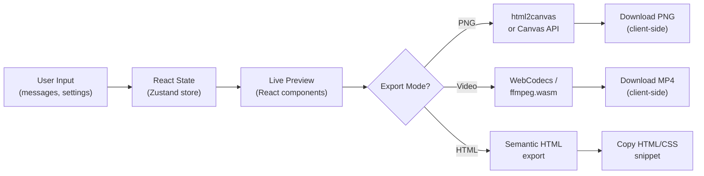

# Product Requirements Document (PRD)
## Social Media Chat & Mockup Generator — "ChatForge" (Working Title)

**Prepared by:** Senior Product Manager  
**Date:** November 25, 2026  
**Status:** DRAFT — Pending Stakeholder Approval (Phase 1 Gate)  
**Sources:** All documents in [/docs/research/](file:///Users/vaibhavborkar/chat%20generator/docs/research/)

---

## 1. Product Vision

**Build the most accurate, fastest, and most creator-friendly social media chat and mockup generator on the web** — combining pixel-perfect platform UIs, free watermark-free exports, animated video generation, AI scripting, and a persistent character workspace, all running 100% client-side with zero ads.

### 1.1 Mission Statement
> Replace the fragmented ecosystem of ad-cluttered legacy utilities, predatory subscription video tools, and time-consuming Figma/After Effects workflows with a single, privacy-first web studio that serves content creators, marketers, filmmakers, educators, and casual users equally.

### 1.2 Core Differentiators
1. **Static + Video in One Tool** — Every chat generator produces both free HD PNGs AND animated 9:16 MP4 videos
2. **Pixel-Perfect, Auto-Updating UIs** — Component-based platform skins (iOS 18+, Android 15+, latest app versions) with dark/light mode, RTL, and locale support
3. **Privacy-First Architecture** — 100% client-side Canvas rendering; zero server uploads for mockup generation
4. **Generous Free Tier** — Watermark-free static PNGs forever; no signup required
5. **Cast & Projects Workspace** — Reusable characters with cloud sync across all generators
6. **AI-Powered Scripting** — Script-paste bulk parser + AI dialogue generation

---

## 2. Target Users (from User Personas)

| Persona | Segment | Key Need | Revenue Potential |
|:---|:---|:---|:---|
| Maya Lin | Content Creators (TikTok/YouTube/IG) | Fast 9:16 animated chat videos with SFX and TTS | **High** ($8–$20/mo) |
| Daniel Ortiz | Social Media Marketers & Agencies | Realistic ad mockups with client approval links | **High** ($15–$29/mo) |
| Elena Vance | Filmmakers & Storytellers | On-set prop playback + accessible HTML/print exports | **Medium** ($5–$49 one-time) |
| Marcus Bell | Educators | Ad-free, zero-login classroom tool with safety badges | **Low** (Free tier / institutional) |
| Tyler Brooks | Casual / Prank Users | Instant watermark-free meme screenshots on mobile | **Low** (Free tier / $2–$5 impulse) |
| Nadia Khoury | Journalists / OSINT | Clearly labeled editorial mockups + verification reference | **Low** (Free / $0–$15/mo) |

---

## 3. Product Architecture

### 3.1 Technical Architecture (Recommended Stack)

> [!IMPORTANT]
> Architecture validated by SEO research and competitor tech analysis. `getmockly.com` (fastest-growing competitor) runs Next.js + React + TypeScript + Tailwind on Vercel — this is the proven pattern for this product category.

```
┌──────────────────────────────────────────────────────────────┐
│                        FRONTEND                               │
│  Next.js 15 (App Router) + React 19 + TypeScript + Tailwind  │
│  ┌─────────────────┐  ┌──────────────────────────────────┐   │
│  │  SSR/SSG Pages   │  │  Client-Side Islands              │  │
│  │  • SEO content   │  │  • Chat canvas (Canvas/SVG)       │  │
│  │  • FAQ schemas   │  │  • html2canvas export             │  │
│  │  • Keyword pages │  │  • WebCodecs video encoder        │  │
│  │  • Blog/guides   │  │  • IndexedDB auto-save            │  │
│  └─────────────────┘  └──────────────────────────────────┘   │
├──────────────────────────────────────────────────────────────┤
│                     BACKEND (Minimal)                          │
│  • Auth: Supabase Auth (social login, magic link)             │
│  • Database: Supabase PostgreSQL (projects, characters, user) │
│  • Storage: Supabase Storage (avatar uploads only)            │
│  • AI: Gemini API / OpenAI API (script generation — Pro)      │
│  • Payments: Stripe (subscriptions, one-time passes)          │
│  • Analytics: Plausible / PostHog (privacy-first)             │
├──────────────────────────────────────────────────────────────┤
│                     INFRASTRUCTURE                            │
│  • Hosting: Vercel (Edge Functions, ISR)                      │
│  • CDN: Vercel Edge Network / Cloudflare                      │
│  • PWA: next-pwa (Service Worker, offline support)            │
│  • Monitoring: Sentry (error tracking)                        │
└──────────────────────────────────────────────────────────────┘
```

### 3.2 Key Architecture Principles
1. **SSR/SSG for SEO, Client Islands for Interactivity** — All meta tags, H1s, instructions, and FAQs rendered server-side. Chat canvas mounts as a hydrated client component with explicit `min-height` to prevent CLS.
2. **Zero Server-Side Rendering of User Content** — All chat mockup rendering happens in the browser via Canvas API / `html2canvas`. Server is never involved in generating mockup images.
3. **Progressive Enhancement** — Core PNG export works without JavaScript if Canvas is available. Video export lazy-loads WebCodecs / ffmpeg.wasm only on demand.
4. **Offline-First PWA** — Service Worker caches generator pages, platform skin assets, and emoji sets. Users can build mockups offline.

### 3.3 Rendering Pipeline


---

## 4. Feature Requirements

### 4.1 Phase 1 — MVP Launch Generators (10 Generators)

Based on SEO keyword priority (P0), competitor gaps, and user persona demand:

| # | Generator | SEO Priority | Target URL | Justification |
|:---|:---|:---|:---|:---|
| 1 | **WhatsApp Chat** | P0 | `/generators/whatsapp-chat` | Highest search volume anchor term; core user demand |
| 2 | **WhatsApp Group Chat** | P1 | `/generators/whatsapp-group-chat` | Group chat differentiation; medium volume |
| 3 | **iPhone iMessage/SMS** | P0 | `/generators/iphone-imessage` | High volume; strong US/UK demand |
| 4 | **Instagram DM** | P0 | `/generators/instagram-dm` | High volume; creator demand |
| 5 | **Twitter/X Post Mockup** | P0 | `/generators/twitter-post` | High volume; disambiguate from AI copy tools |
| 6 | **Telegram Chat** | P1 | `/generators/telegram-chat` | Medium-high volume; international demand |
| 7 | **Discord Chat** | P1 | `/generators/discord-chat` | Low-medium competition; gaming/community demand |
| 8 | **Snapchat Chat** | P1 | `/generators/snapchat-chat` | Medium competition; niche demand |
| 9 | **Facebook Messenger** | P1 | `/generators/messenger-chat` | Medium competition; broad audience |
| 10 | **AI Chat Mockup (ChatGPT/Claude/Gemini)** | P0 | `/generators/ai-chat-mockup` | Blue ocean; high B2B value |

### 4.2 Core Features (All Generators)

#### 4.2.1 Chat Editor
- [ ] Two-sided message editing (sender/receiver toggle)
- [ ] Custom contact names and avatars (upload or select)
- [ ] Custom timestamps with locale-aware formatting
- [ ] Delivery/read receipts (single tick, double tick, blue tick, "Seen", "Delivered")
- [ ] Online/offline/"typing..." / "last seen" status
- [ ] Verified badges / checkmarks
- [ ] Message reactions (platform-appropriate emoji sets)
- [ ] Voice message blocks with waveform visualization and duration
- [ ] Image message attachments (client-side, never uploaded)
- [ ] Reply-to-message quote bubbles
- [ ] System messages ("Alex added Taylor to the group")
- [ ] Dark mode / Light mode toggle
- [ ] iOS vs Android UI toggle (where applicable)

#### 4.2.2 Multi-Speaker Group Chat
- [ ] Unlimited named participants with auto-assigned color coding
- [ ] Custom per-participant avatars and display names
- [ ] Group name and group icon editing
- [ ] "X is typing..." indicators for specific members
- [ ] Admin badges and role indicators

#### 4.2.3 Status Bar & Device Frame
- [ ] Customizable status bar (time, battery %, Wi-Fi, cellular signal)
- [ ] iOS / Android status bar variants
- [ ] Toggle status bar on/off (for presentation use)
- [ ] Optional device frame overlay (iPhone/Android bezel)

#### 4.2.4 Export Engine
- [ ] **Free PNG** — Watermark-free, high-resolution (2x/3x retina), zero signup
- [ ] **Free JPEG** — Compressed option for quick sharing
- [ ] **Pro Video (MP4)** — 9:16, 4:5, 1:1 aspect ratios; up to 4K 60fps; typing indicators, message fade-in, SFX
- [ ] **Pro Transparent Overlay** — Alpha-channel PNG or WebM for video editors
- [ ] **Pro Batch/Carousel** — Multi-slide PNG set + ZIP download
- [ ] **Pro PDF** — For educators and presentation use
- [ ] **HTML/CSS Snippet** — Copyable semantic markup for fiction writers/accessibility

#### 4.2.5 Input Methods
- [ ] Manual message-by-message editor (click/tap to add)
- [ ] **Script-Paste Parser** — Paste `Name: Message` format to auto-build conversations
- [ ] **AI Script Generator** (Pro) — Natural language prompt → generated dialogue
- [ ] Template starter scenarios (Customer Support, Date Gone Wrong, Delivery Update, etc.)

#### 4.2.6 Persistence & Workspace
- [ ] IndexedDB auto-save (zero signup, survives tab refresh)
- [ ] Cloud-synced projects (authenticated users)
- [ ] Reusable Cast of Characters library (name, avatar, handle, voice preset)
- [ ] Project history with version snapshots

### 4.3 Platform-Specific Features

#### WhatsApp
- [ ] Single/double/blue ticks, "typing..." bubble
- [ ] Voice notes with blue waveform and duration
- [ ] Link previews with thumbnail cards
- [ ] Forwarded message labels ("Forwarded", "Frequently Forwarded")
- [ ] Star message indicator
- [ ] WhatsApp Business verified green checkmark
- [ ] Locale-aware ("online", "typing...", "today", timestamps in locale format)

#### iMessage / SMS
- [ ] Blue (iMessage) vs Green (SMS) bubble toggle
- [ ] Tapback reactions (heart, thumbs up, Ha Ha, !!, ?)
- [ ] "Delivered" / "Read" with timestamp
- [ ] Dynamic Island / notch status bar (iOS 17/18+)
- [ ] MMS image/video message support

#### Instagram DM
- [ ] Purple/blue gradient sender bubbles
- [ ] Story reply format
- [ ] Shared post / shared reel cards
- [ ] Vanish mode indicator
- [ ] Voice message pills
- [ ] Emoji quick-reactions

#### Twitter/X Post Mockup
- [ ] Tweet with engagement metrics (likes, reposts, bookmarks, views)
- [ ] Verified / Blue / Gold badge options
- [ ] Community Notes
- [ ] Quote tweet
- [ ] Reply thread (nested)
- [ ] Desktop and mobile layout toggle
- [ ] Light / Dim / Dark theme

#### AI Chat Mockup
- [ ] ChatGPT, Claude, Gemini, Grok, Perplexity UI themes
- [ ] Markdown rendering (headings, bold, italic, lists, code blocks)
- [ ] Syntax-highlighted code blocks
- [ ] "Thinking..." / "Reasoning..." indicator
- [ ] Model logo and version badge
- [ ] Copy code button visual element
- [ ] User message vs assistant message styling

### 4.4 Non-Functional Requirements

#### Performance
- [ ] LCP < 2.5s on 4G mobile
- [ ] INP < 200ms for all interactive elements
- [ ] CLS < 0.05 (fixed canvas container dimensions)
- [ ] Total JS bundle < 200KB initial (lazy-load platform skins and export libraries)
- [ ] Lighthouse Performance score ≥ 90

#### SEO
- [ ] SSR/SSG for all generator pages (crawlable HTML with meta tags, H1, instructions, FAQ)
- [ ] `WebApplication` JSON-LD schema on every generator page
- [ ] `FAQPage` JSON-LD schema with 4–6 platform-specific questions
- [ ] `BreadcrumbList` schema reinforcing `/generators/` hierarchy
- [ ] `HowTo` schema for step-by-step instructions below the fold
- [ ] Self-referencing canonical URLs; `noindex` on user-generated preview URLs
- [ ] OpenGraph and Twitter Card meta tags with generator-specific preview images
- [ ] `hreflang` tags for international pages (Phase 2+)

#### PWA
- [ ] Service Worker with offline cache for generator pages and static assets
- [ ] Web App Manifest with installable prompt
- [ ] Background sync for project auto-save
- [ ] Push notifications for export completion (long video renders)

#### Accessibility
- [ ] WCAG 2.1 AA compliance for editor UI
- [ ] Keyboard navigable chat editor
- [ ] Screen reader labels for all interactive controls
- [ ] High contrast mode support
- [ ] Focus management and ARIA attributes

#### Security & Privacy
- [ ] 100% client-side mockup rendering (zero server uploads for content)
- [ ] CSP headers preventing XSS
- [ ] No third-party tracking scripts (use privacy-first analytics)
- [ ] GDPR-compliant data handling for authenticated users
- [ ] Clear privacy policy and "Your data stays in your browser" messaging

---

## 5. Pricing Model

Based on verified user pricing sensitivity from user research:

| Tier | Price | Includes | Target Persona |
|:---|:---|:---|:---|
| **Free** | $0 forever | Watermark-free HD PNGs, all generators, IndexedDB auto-save, 3 Cast characters, template starters, "Simulated" badge option | Tyler, Marcus, Nadia, all top-of-funnel |
| **7-Day Pass** | $4.99 | Everything in Free + 4K/60fps MP4 video, transparent overlays, batch ZIP, PDF export, unlimited Cast characters, AI script (10 uses) | Elena (film shoots), Daniel (pitch week) |
| **Creator Pro** | $9.99/mo | Everything in Pass + unlimited video renders, AI script (unlimited), custom brand kit, priority export queue, cloud sync (50 projects) | Maya, solo creators |
| **Agency Pro** | $24.99/mo | Everything in Creator + team workspace (5 seats), no-login client review links, white-label exports, API access (1,000 renders/mo) | Daniel (agency), B2B teams |
| **Lifetime** | $49 (promo) / $79 (reg) | Creator Pro features, forever | Elena, power users |

> [!TIP]
> Key pricing insights from research:
> - Static PNG exports are commoditized at $0 — never charge for them
> - Episodic users (filmmakers, pitch-season agencies) strongly prefer non-recurring passes
> - $4.99–$7.99 7-day passes have proven traction at `thefake.design`
> - $19/mo+ AI video tools without free trials face massive Trustpilot backlash

---

## 6. Trust & Safety Requirements

- [ ] **Explicit exclusions:** No financial receipt generators (GPay, PayPal, Venmo, bank transfers), no ID/document generators, no fake verification email generators
- [ ] **Optional "Simulated / Mockup" badge** — Toggleable header pill for educators, journalists, and compliance
- [ ] **Terms of Use** — Clear acceptable use policy (education, creative storytelling, marketing mockups, satire) with prohibited uses (fraud, impersonation, evidence fabrication, harassment)
- [ ] **Blog content** — "How to Spot a Fake Screenshot" forensic guide (builds E-E-A-T trust)
- [ ] **Report abuse** — Email-based abuse reporting workflow
- [ ] **No payment receipt tools** — Explicit brand decision to avoid fraud-adjacent surfaces (learned from `mockly.fun` brand collision)

---

## 7. Success Metrics (Phase 1 — First 90 Days)

| Metric | Target | Measurement |
|:---|:---|:---|
| Generator pages launched | 10 | Ship tracker |
| Monthly organic visits | 50K+ | Plausible/PostHog |
| PNG exports generated | 100K+ | Client-side event tracking |
| Free-to-Pass conversion | 3–5% | Stripe + analytics |
| Core Web Vitals (all pages) | Green (Good) | Google Search Console |
| Lighthouse Performance | ≥ 90 | CI/CD automated checks |
| Time-to-first-export (new user) | < 60 seconds | Analytics funnel |

---

## 8. Out of Scope (Phase 1)

- Mobile native apps (iOS/Android) — web-first PWA strategy
- Video AI voiceover / TTS integration — Phase 2
- Split-screen looping background video composer — Phase 2
- International localization (`/es/`, `/pt/`, etc.) — Phase 2
- Render API for developers — Phase 3
- Real-time collaborative editing — Phase 3
- Regional messaging apps (LINE, KakaoTalk, WeChat) — Phase 3

---

## 9. Approval Gate

> [!IMPORTANT]
> **This document is DRAFT status.** No application development should begin until:
> 1. Stakeholder reviews and approves the 10 initial generators
> 2. Technology architecture is confirmed
> 3. Pricing model is validated
> 4. Implementation roadmap timeline is agreed upon
>
> Proceed to Phase 2 (Design & Development) only after written approval.
