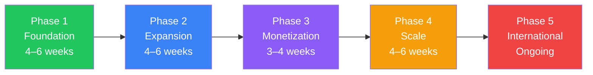

# Implementation Roadmap — Social Media Chat & Mockup Generator

**Prepared by:** Senior Product Manager, Senior Technical Lead, Senior SEO Specialist  
**Date:** November 25, 2026  
**Status:** PROPOSED — Pending Stakeholder Approval  

---

## 1. Roadmap Philosophy

This roadmap follows a **product-led SEO growth** strategy:
1. **Ship high-SEO-value generators first** — Target P0 keywords with the least competition
2. **Free watermark-free PNGs drive organic growth** — Reddit, Twitter, and word-of-mouth
3. **Video export is the monetization wedge** — Freemium upgrade from free static to paid animated
4. **Progressive platform expansion** — Add generators based on SEO opportunity and user demand signals

> [!NOTE]
> Timeline estimates assume a team of 2–3 developers working full-time. Adjust accordingly for team size.

---

## 2. Phase Overview

---

## 3. Phase 1 — Foundation (Weeks 1–6)

**Goal:** Launch core platform with 4 high-priority generators, free PNG export, and SEO-optimized pages.

### 3.1 Architecture & Infrastructure (Week 1–2)

| Task | Owner | Details |
|:---|:---|:---|
| Project scaffolding | Frontend Dev | Next.js 15 App Router + TypeScript + Tailwind CSS + Zustand |
| Component architecture | Frontend Dev | Shared chat components: `MessageBubble`, `StatusBar`, `Avatar`, `ChatContainer`, `ExportCanvas` |
| Canvas rendering engine | Frontend Dev | `html2canvas` / Canvas API abstraction for PNG export |
| PWA setup | PWA Dev | `next-pwa`, Service Worker, Web App Manifest, offline caching |
| Supabase setup | Backend Dev | Auth, PostgreSQL schema (users, projects, characters), Storage bucket |
| CI/CD pipeline | DevOps | Vercel deployment, Lighthouse CI, ESLint, TypeScript strict mode |
| Design system | UI/UX Designer | Color tokens, typography scale, spacing, component library (Figma → code) |

### 3.2 Core Generator Engine (Week 2–4)

| Task | Owner | Details |
|:---|:---|:---|
| **Shared Editor Framework** | Frontend Dev | Message list state management, add/edit/delete/reorder messages, sender toggle, timestamp editor, drag-to-reorder |
| **Platform Skin System** | Frontend Dev | Pluggable skin architecture: each platform provides bubble styles, fonts, colors, status bar, receipts. Config-driven so new platforms = new config + minimal components |
| **Export Engine** | Frontend Dev | PNG: `html2canvas` → `Blob` → download. JPEG: compressed variant. All client-side. |
| **IndexedDB Auto-Save** | Frontend Dev | Auto-persist current project to IndexedDB on every change. Restore on page load. |

### 3.3 First 4 Generators (Week 3–5)

| # | Generator | SEO Target | Key Features |
|:---|:---|:---|:---|
| 1 | **WhatsApp Chat** | `fake whatsapp chat generator` (Very High volume) | 1-on-1 + group mode, single/double/blue ticks, voice notes, dark/light, iOS/Android toggle, link previews |
| 2 | **iPhone iMessage** | `fake iphone text generator` (High volume) | Blue/green bubble toggle, Tapback reactions, Delivered/Read, Dynamic Island status bar, dark mode |
| 3 | **Instagram DM** | `instagram dm generator online` (High volume) | Gradient bubbles, story replies, shared post/reel cards, voice pills, vanish mode, dark/light |
| 4 | **AI Chat Mockup** | `ai chat screenshot generator` (Low competition, emerging) | ChatGPT/Claude/Gemini themes, Markdown rendering, code blocks, thinking indicator, model badges |

### 3.4 SEO & Content (Week 4–6)

| Task | Owner | Details |
|:---|:---|:---|
| SEO page templates | Content SEO | SSR generator pages with keyword-optimized `<title>`, `<meta description>`, H1, step-by-step instructions, FAQ accordion |
| JSON-LD schemas | Technical SEO | `WebApplication`, `FAQPage`, `BreadcrumbList`, `HowTo` on each generator page |
| OpenGraph images | UI/UX Designer | Generator-specific OG preview images for social sharing |
| Landing page | Frontend Dev | Homepage with generator grid, value propositions, trust badges ("100% Client-Side", "No Watermark", "Free Forever") |
| Blog: "How to Spot Fake Screenshots" | Content SEO | E-E-A-T trust content targeting informational keywords |
| Blog: "Are Fake Chat Generators Legal?" | Content SEO | FAQ/legal trust content |

### 3.5 QA & Launch (Week 5–6)

| Task | Owner | Details |
|:---|:---|:---|
| Cross-browser testing | QA Engineer | Chrome, Firefox, Safari, Edge (desktop + mobile) |
| Mobile responsiveness | QA Engineer | iPhone SE → iPad Pro, Android small → tablet |
| Lighthouse audit | QA Engineer | Performance ≥ 90, Accessibility ≥ 90, SEO ≥ 95, Best Practices ≥ 90 |
| Core Web Vitals validation | Technical SEO | LCP < 2.5s, INP < 200ms, CLS < 0.05 on all generator pages |
| PNG export quality audit | QA Engineer | Pixel-accuracy checks against real app screenshots (iOS 18, Android 15) |
| Privacy audit | Backend Dev | Verify zero server uploads during mockup generation; CSP headers; privacy policy |
| Soft launch | Product Manager | ProductHunt Upcoming, Reddit `r/SideProject` launch post |

### Phase 1 Deliverable
✅ 4 fully functional generators live at production URLs  
✅ Free watermark-free PNG export on all generators  
✅ SEO-optimized pages ranking for target keywords  
✅ PWA installable with offline support  
✅ IndexedDB auto-save persistence  

---

## 4. Phase 2 — Expansion (Weeks 7–12)

**Goal:** Add 6 more generators, group chat engine, Cast workspace, and script-paste parser.

### 4.1 Additional Generators

| # | Generator | SEO Target | Priority |
|:---|:---|:---|:---|
| 5 | **Twitter/X Post Mockup** | `fake tweet generator` | P0 |
| 6 | **WhatsApp Group Chat** | `whatsapp group chat generator` | P1 |
| 7 | **Telegram Chat** | `telegram chat generator` | P1 |
| 8 | **Discord Chat** | `fake discord chat generator` | P1 |
| 9 | **Snapchat Chat** | `fake snapchat generator` | P1 |
| 10 | **Facebook Messenger** | `messenger chat generator` | P1 |

### 4.2 Platform Features

| Feature | Details |
|:---|:---|
| **Multi-Speaker Group Chat Engine** | Unlimited participants, auto-color-coding, reply-to-quote bubbles, typing collisions, system events, polls |
| **Cast of Characters** | Create, name, assign avatars, reuse across generators. Free: 3 characters. Pro: unlimited. Cloud sync for authenticated users. |
| **Script-Paste Parser** | Paste `Name: Message` screenplay format → auto-build conversation with 30+ messages instantly |
| **Template Starter Library** | 5–10 pre-built scenario starters per generator (Customer Support, Date Gone Wrong, Delivery Update, Scam Warning, Study Group) |

### 4.3 Content & SEO Expansion

| Task | Details |
|:---|:---|
| 6 new generator SEO pages | Keyword-optimized pages for each new generator |
| Comparison pages | `/compare/best-fake-chat-apps-vs-web`, `/compare/social-media-mockup-tools` |
| Use-case pages | `/use-cases/presentation-chat-mockups`, `/use-cases/content-creator-chat-videos` |
| Blog posts | Platform-specific tutorials ("How to Create a Realistic WhatsApp Group Chat Mockup") |

### Phase 2 Deliverable
✅ 10 total generators live  
✅ Full group chat support on WhatsApp, Telegram, Discord, Messenger  
✅ Cast of Characters workspace with cloud sync  
✅ Script-paste bulk import  
✅ Template starter library  

---

## 5. Phase 3 — Monetization (Weeks 13–16)

**Goal:** Launch video export, AI scripting, and paid tiers.

### 5.1 Video Export Engine

| Feature | Details |
|:---|:---|
| **Animated MP4 Export** | WebCodecs / ffmpeg.wasm; message-by-message fade-in with typing indicator animation |
| **Aspect Ratios** | 9:16 (TikTok/Reels/Shorts), 4:5 (IG Feed), 1:1 (Square) |
| **Resolution** | Up to 4K 60fps (Pro); 720p with watermark (Free preview) |
| **Sound Effects** | Optional message send/receive pop sounds |
| **Per-Message Timing** | Customizable delay between messages, typing duration, read receipt delay |
| **Transparent Overlay** | Alpha-channel WebM/ProRes for video editors (Pro) |

### 5.2 AI Script Generation

| Feature | Details |
|:---|:---|
| **Prompt-to-Script** | "Generate a dramatic breakup conversation over WhatsApp with 20 messages" → populated chat |
| **API Integration** | Gemini API (primary) with OpenAI fallback |
| **Free Tier** | 3 AI generations/day |
| **Pro Tier** | Unlimited AI generations |

### 5.3 Payment Infrastructure

| Feature | Details |
|:---|:---|
| **Stripe Integration** | Subscriptions, one-time passes, lifetime deals |
| **Pricing Tiers** | Free, 7-Day Pass ($4.99), Creator Pro ($9.99/mo), Agency Pro ($24.99/mo), Lifetime ($49–$79) |
| **Free Trial** | 3-day Creator Pro trial (no credit card required) |
| **Transparent Cancellation** | 1-click cancel in dashboard; no dark patterns |

### Phase 3 Deliverable
✅ Video export (MP4) working on all 10 generators  
✅ AI script generation integrated  
✅ Stripe payments live with all pricing tiers  
✅ Revenue generation active  

---

## 6. Phase 4 — Scale & Differentiation (Weeks 17–22)

**Goal:** Add adjacent surfaces, B2B features, comment overlays, and advanced export formats.

### 6.1 New Generators & Surfaces

| Generator / Surface | SEO Target |
|:---|:---|
| **TikTok Comment Overlay** (transparent PNG) | `tiktok comment overlay generator transparent png` |
| **YouTube Comment** (transparent PNG) | `youtube comment generator overlay` |
| **Facebook Post Mockup** | `facebook post generator mockup` |
| **Instagram Post Mockup** | `instagram post mockup generator` |
| **Instagram Story Mockup** | `fake instagram story mockup generator` |
| **Slack Chat** | `slack chat mockup generator` |
| **Lock Screen Notification** | `fake notification generator` |
| **Reddit Post Mockup** | `reddit post and comment mockup generator` |
| **LinkedIn Post** | `linkedin post mockup generator` |
| **Fake Call Screen** | `fake call screen generator` |

### 6.2 B2B & Agency Features

| Feature | Details |
|:---|:---|
| **Team Workspace** | Multi-seat access with shared Cast, projects, and brand kits |
| **No-Login Client Review Links** | Shareable preview links for client approval (no login required for reviewer) |
| **White-Label Exports** | Remove product branding from Pro exports |
| **Batch Export** | Multi-slide carousel PNGs + ZIP download |
| **Brand Kit** | Custom brand colors, logos, and watermark presets for agency clients |

### 6.3 Advanced Features

| Feature | Details |
|:---|:---|
| **Filmmaker Prop Mode** | Full-screen PWA playback mode — tap to advance next message (no media player HUD) |
| **HTML/CSS Export** | Semantic markup export for fiction writers (AO3 workskins, screen readers) |
| **Print-Friendly B&W** | Grayscale/retro theme for RPG handouts and educational materials |
| **Generic / Film-Safe UI** | Custom rounded-bubble theme without Apple/Meta trademarked status bar elements |

### Phase 4 Deliverable
✅ 20+ total generators and surfaces  
✅ B2B team workspace and client review links  
✅ Comment overlay generators (transparent PNG)  
✅ Filmmaker Prop Mode  

---

## 7. Phase 5 — International & Ongoing Growth (Weeks 23+)

**Goal:** International SEO expansion, regional messaging apps, Render API.

### 7.1 Internationalization

| Phase | Languages | Justification |
|:---|:---|:---|
| 5a | Spanish (`/es/`), Portuguese-BR (`/pt/`) | Largest WhatsApp markets; zero native web competitors |
| 5b | Indonesian (`/id/`), German (`/de/`), French (`/fr/`), Hindi (`/hi/`), Turkish (`/tr/`) | High mobile-first WhatsApp/IG usage; English tools currently ranking by default |
| 5c | Arabic (`/ar/`) with RTL support, Japanese (`/ja/`), Korean (`/ko/`), Thai (`/th/`) | Telegram (CIS), LINE (Japan/Thailand), KakaoTalk (Korea) markets |

### 7.2 Regional Messaging Apps

| App | Target Market | Competition Level |
|:---|:---|:---|
| **LINE Chat** | Japan, Thailand, Taiwan | Very Low (only `getmockly.com`, `thefake.design`) |
| **KakaoTalk Chat** | South Korea | Very Low (only `thefake.design`, `altftool.com`) |
| **WeChat Chat** | China / diaspora | Very Low (only `wechatmessagegenerator.com`) |

### 7.3 Developer API

| Feature | Details |
|:---|:---|
| **Render API** | RESTful API for programmatic mockup generation (image + video) |
| **Pricing** | $49/mo (5,000 renders), $99/mo (15,000 renders), $199/mo (50,000 renders) |
| **Use Cases** | SaaS onboarding demos, marketing automation, A/B testing creative variants |

### 7.4 AI Video Enhancements (Phase 5b)

| Feature | Details |
|:---|:---|
| **Multi-Speaker AI TTS Voiceover** | Per-character AI voice assignment with pacing controls |
| **Split-Screen Background Composer** | Looping background video templates (satisfying loops, gameplay) below chat overlay |
| **Auto-Captioning** | Burned-in captions for accessibility and engagement |

---

## 8. 10 Most Valuable Initial Generators (Recommended)

Based on synthesized SEO priority, competitor gaps, user persona demand, and technical feasibility:

| Rank | Generator | Why First? |
|:---|:---|:---|
| 1 | **WhatsApp Chat** | #1 search volume anchor; global demand; core competitive benchmark |
| 2 | **iPhone iMessage/SMS** | High US/UK demand; strong creator use (TikTok text stories) |
| 3 | **AI Chat Mockup (ChatGPT/Claude/Gemini)** | Blue ocean — lowest competition, highest growth, strong B2B value |
| 4 | **Instagram DM** | High creator demand; gradient bubbles and story replies differentiate |
| 5 | **Twitter/X Post Mockup** | High volume; disambiguate from AI copy tools to capture visual mockup intent |
| 6 | **WhatsApp Group Chat** | Multi-speaker differentiation; under-built by all competitors |
| 7 | **Discord Chat** | Gaming/community audience; role colors, bot tags, server channels |
| 8 | **Telegram Chat** | Strong international demand (Eastern Europe, LATAM, Web3); medium competition |
| 9 | **Snapchat Chat** | Niche but loyal prank/meme audience; medium competition |
| 10 | **Facebook Messenger** | Broad audience; completes the "Big 5" messaging app coverage |

---

## 9. Technology Architecture Recommendation

| Layer | Technology | Rationale |
|:---|:---|:---|
| **Framework** | Next.js 15 (App Router) | SSR/SSG for SEO + React client islands for interactivity. Proven by `getmockly.com`. |
| **Language** | TypeScript (strict mode) | Type safety for complex platform skin configs and state management |
| **Styling** | Tailwind CSS 4 | Rapid UI development; design token system; purged CSS for minimal bundle |
| **State** | Zustand | Lightweight, TypeScript-first state management for chat editor state |
| **Canvas/Export** | html2canvas + Canvas API | Client-side PNG rendering; proven in `fauxtalks.com` architecture |
| **Video Export** | WebCodecs API (primary) + ffmpeg.wasm (fallback) | Modern browser-native video encoding; ffmpeg.wasm for older browsers |
| **Auth** | Supabase Auth | Social login, magic link, email/password; generous free tier |
| **Database** | Supabase PostgreSQL | Projects, characters, user preferences; Row Level Security |
| **Storage** | Supabase Storage | Avatar/image uploads only; mockup content never touches server |
| **Payments** | Stripe | Subscriptions, one-time passes, lifetime deals, customer portal |
| **AI** | Google Gemini API | Script generation; cost-effective for high-volume creative text |
| **Hosting** | Vercel | Edge deployment, ISR, Analytics, Speed Insights |
| **PWA** | next-pwa / Serwist | Service Worker, offline cache, installable web app |
| **Analytics** | Plausible / PostHog | Privacy-first, GDPR-compliant, no cookie banners needed |
| **Monitoring** | Sentry | Error tracking, performance monitoring |
| **Testing** | Vitest + Playwright | Unit tests (Vitest), E2E tests (Playwright), visual regression |

---

## 10. Risk Assessment

| Risk | Likelihood | Impact | Mitigation |
|:---|:---|:---|:---|
| Platform UI changes (WhatsApp/iOS updates) | High | Medium | Component-based skin system; design tokens; monthly visual QA audit against real apps |
| App Store takedown (if we launch native apps) | Medium | High | Web-first PWA strategy; delay native apps; include TOS/safety guardrails |
| SEO competition from established players | High | Medium | Target long-tail keywords first; win on Core Web Vitals and UX quality |
| AI content policy changes (script generation) | Low | Medium | Generic Gemini/OpenAI API; content moderation layer; human review option |
| Browser API deprecation (html2canvas, WebCodecs) | Low | Low | Canvas API is stable; WebCodecs has broad Chromium support; ffmpeg.wasm as fallback |
| Ethical misuse (fraud, harassment) | Medium | High | No payment receipt generators; "Simulated" badge; clear TOS; abuse reporting |

---

## 11. Approval Gate Checklist

> [!IMPORTANT]
> **Before proceeding to Phase 2 (Design & Development), confirm:**
> 
> - [ ] 10 initial generators approved
> - [ ] Technology architecture (Next.js + Supabase + Vercel) approved
> - [ ] Pricing model validated
> - [ ] Product name / branding direction decided
> - [ ] Phase 1 timeline (4–6 weeks) confirmed
> - [ ] Team composition and resource allocation confirmed
> - [ ] Design system / UI mockups process initiated
> 
> **This document serves as the Phase 1 Approval Gate. No code should be written until approval is granted.**
