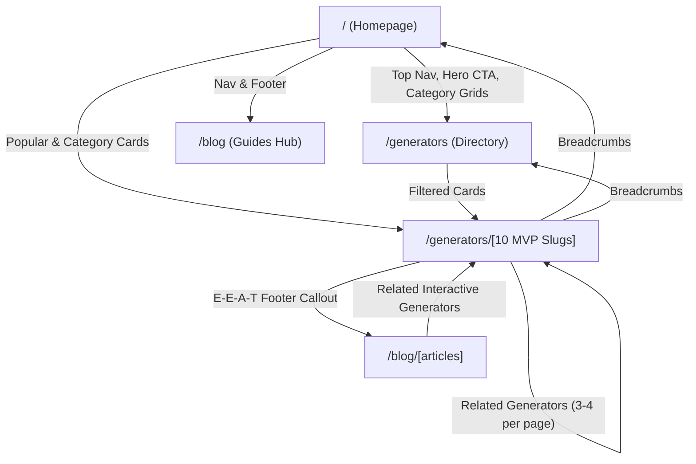

# Internal Linking Plan

**Prepared by:** Content & Technical SEO Strategist  
**Date:** November 25, 2026  

---

## 1. Hub-and-Spoke Link Flow

## 2. Contextual Cross-Linking Matrix Across the 10 MVP Generators

| Source Page | Contextual Related Generator Links (`relatedSlugs`) | Intent Rationale |
|:---|:---|:---|
| `/generators/whatsapp-chat` | `whatsapp-group-chat`, `imessage`, `instagram-dm`, `fake-call-screen` | Bridges 1:1 WhatsApp users to Group threads, iMessage, IG DMs, and Call overlays |
| `/generators/whatsapp-group-chat` | `whatsapp-chat`, `discord-chat`, `telegram-chat`, `imessage` | Connects multi-speaker group creators across WA Group, Discord, and Telegram |
| `/generators/instagram-dm` | `instagram-story`, `instagram-post`, `whatsapp-chat`, `imessage` | Forms a full Instagram Creator cluster (DM + Story + Post) |
| `/generators/instagram-story` | `instagram-post`, `instagram-dm`, `whatsapp-chat`, `fake-call-screen` | Links Story designers to Post truncation checks and DM story replies |
| `/generators/instagram-post` | `instagram-story`, `instagram-dm`, `whatsapp-chat`, `discord-chat` | Connects social marketers from Feed posts to Stories and DM social proof |
| `/generators/imessage` | `android-messages`, `whatsapp-chat`, `fake-call-screen`, `instagram-dm` | Connects US/iOS SMS storytellers to Android RCS comparisons and call openers |
| `/generators/android-messages` | `imessage`, `whatsapp-chat`, `telegram-chat`, `fake-call-screen` | Bridges Android RCS creators with iMessage and WhatsApp |
| `/generators/telegram-chat` | `discord-chat`, `whatsapp-chat`, `whatsapp-group-chat`, `android-messages` | Connects community/channel admins across Telegram and Discord |
| `/generators/discord-chat` | `whatsapp-group-chat`, `telegram-chat`, `whatsapp-chat`, `instagram-dm` | Cross-links server/community builders with WhatsApp Groups and Telegram |
| `/generators/fake-call-screen` | `whatsapp-chat`, `imessage`, `instagram-dm`, `instagram-story` | Connects video intro hooks (call screens) to the chat/story threads they cut into |

## 3. Orphan Page Prevention
- **0 orphan pages:** Every indexable URL is linked directly from at least 2 crawlable `<Link href="...">` paths (Header/Footer, Directory, Related Generators, or Guides Hub) and listed in `/sitemap.xml` child sitemaps.
